# 单元⑤ · AI Infra与计算机基础

**本单元目标**：知道训练和推理的资源花在哪里，能算batch、显存和KV cache；再掌握选择题常用的数据结构、复杂度、系统与网络概念。本单元内容较多，建议分成“Infra”和“计算机基础”两次学。

## 1. 从样本到token，再到显存

一个**样本**可以是一段文本；**token**是分词器处理后的基本单元，可能是一个字、一个词的一部分或其他片段，不能固定当作一个汉字。**batch**包含多个样本；不同样本的token数量可能不同。

GPU显存不仅存模型参数，还可能存：梯度、优化器状态、前向激活、临时缓冲、通信缓冲。推理还可能存KV cache。估算时必须先问“包含哪些项、每项精度是多少”。

1 byte=8 bit；FP32通常每元素4 byte，FP16／BF16通常2 byte，INT8通常1 byte。这里描述存储精度，不代表速度一定按字节比例提高。

十进制 $1\ \mathrm{GB}=10^9$ byte；二进制 $1\ \mathrm{GiB}=2^{30}$ byte、$1\ \mathrm{MiB}=2^{20}$ byte。算式相同，换算单位不同。

**带算例**：题设每参数包含FP16权重2 byte、FP16梯度2、FP32主权重4、Adam两个FP32状态共8，合计16 byte。十亿参数需 $10^9\times16=16$ GB，约14.90 GiB。未计激活和其他开销，不能据此断言16 GB显卡一定能训练。

## 2. DP、TP、PP：到底切分了什么

### ① 先分清：处理一小批数据，与更新一次参数

训练的基本顺序是：**读入数据 → 前向计算预测和loss → 反向传播得到梯度 → 优化器更新参数** 。梯度可以先存下来，不必每次反向传播后都立刻更新参数。

**microbatch（微批）** 是一次送进去计算的一小批样本。假设显存一次只能容纳3个样本，就先算3个、再算下一批3个。**梯度累积** 是把连续几批产生的梯度累积起来，最后才做一次参数更新；累积期间，模型参数保持不变。例如累积5批再更新，这一次更新就利用了 $3\times5=15$ 个样本的信息。不是对同一批样本反复训练5次，也不是更新参数5次。

| 符号／术语 | 本节的明确含义 | 例子 |
| --- | --- | --- |
| $D$：DP度 | 有多少组模型副本分别处理不同数据；“度”就是数量 | $D=2$：两组分别取数据 |
| $B$：microbatch size | **每个DP副本** 每一小批有多少个样本 | $B=3$：每组每批3个样本 |
| $K$：梯度累积次数 | **每个DP副本** 在一次参数更新前，累计处理多少小批 | $K=5$：处理5批后才更新 |
| $G$：有效全局batch | 全部DP副本合计，一次参数更新用到的样本数 | 后面算得 $G=30$ |

这里的batch按**样本数** 计，不是token数。字母是本节约定；题目若换了字母，先按含义对号入座。

### ② DP：多组模型分别读不同数据，为什么得到D×B×K？

**DP（Data Parallelism，数据并行）** ：普通DP让各设备持有相同的完整模型，各自处理不同样本，随后合并／平均梯度，按一致的规则更新参数。目的是让多个设备一起处理更多数据。它们共同训练的是同一个模型，不是各自训练出不同的模型再投票。

先只看DP，设两台GPU各放一份模型，$D=2$、$B=3$、$K=5$。给这一次更新所用的样本编号：

| 第几批 | 副本甲读入 | 副本乙读入 | 全局新增样本数 |
| --- | --- | --- | --- |
| 第1批 | 样本1～3 | 样本4～6 | 6 |
| 第2批 | 样本7～9 | 样本10～12 | 6 |
| 第3批 | 样本13～15 | 样本16～18 | 6 |
| 第4批 | 样本19～21 | 样本22～24 | 6 |
| 第5批 | 样本25～27 | 样本28～30 | 6 |
| 随后更新一次参数 | 甲累计15个样本 | 乙累计15个样本 | 总计30 |

**先数一组：** 每批 $B$ 个，连续 $K$ 批，一组共 $BK$ 个。**再数全部组：** 有 $D$ 组各自读数据，总计 $D(BK)$ 个。因此：

$$G=D\times B\times K=2\times3\times5=30$$

**DBK只是三个数量相乘，不是一个新的专有名词。** 可以背成：“几组数据 × 每组每批多少样本 × 几批才更新”。不累积时 $K=1$；只有一组时 $D=1$。

再理解它为什么能合成一次更新：假设每个microbatch的loss取样本均值，各批大小相同。将每批loss除以 $K$ 再反向传播，各副本累积后再对 $D$ 组梯度取平均，得到全部 $DBK$ 个样本的平均梯度。实际框架可能自动缩放，不能重复除。合并梯度的通信可以每批发生，也可以延后；关键是**这K批中间没有参数更新** 。涉及BatchNorm等批内统计时，累积小批与一次大批的计算不一定完全一致。

### ③ TP：把同一层的计算分给多张卡

**TP（Tensor Parallelism，张量并行）** 切的是一层内部的权重张量和计算。先把一层想成矩阵乘法 $Y=XW$：$X$ 是输入，$W$ 是权重，$Y$ 是输出。

例如一批有3个样本，每个输入4维，要输出6维，则 $X$ 是 $3\times4$，$W$ 是 $4\times6$，输出 $Y$ 是 $3\times6$。若TP=2，可以把 $W$ 的6列拆成两块，每块3列：

$$W=[W_1\;W_2],\qquad Y=[XW_1\;XW_2]$$

| 分工 | 权重大小 | 本卡算出的结果 |
| --- | --- | --- |
| GPU甲 | $W_1$：$4\times3$ | 同样3个样本的前3个输出分量：$XW_1$ |
| GPU乙 | $W_2$：$4\times3$ | 同样3个样本的后3个输出分量：$XW_2$ |
| 两部分合起来 | 原来的 $4\times6$ 权重 | 3个样本的完整6维输出 |

**样本还是3个，只是每个样本的输出由两张卡合作算完，因此不能把batch再乘TP。** 这里选按列切分作示例；按其他维度切分可能需要把部分结果求和。实现中也可能让输出继续保持分片，交给下一层处理，不必每层都立刻拼回完整张量。

TP可让一层的大矩阵分摊到多卡，但各卡需要交换中间结果，通信代价不能忽略。不要把“切成两份”理解为训练必然快两倍，或所有显存占用必然减半。

### ④ PP：把前后不同的层放在不同设备上

**PP（Pipeline Parallelism，流水线并行）** 沿着模型的层／阶段切分。假设模型有4层、PP=2：GPU甲负责第1～2层，GPU乙负责第3～4层。

**同一批样本的路径：** 样本 → 甲的第1～2层 → 中间激活 → 乙的第3～4层 → 输出与loss。反向传播时，相应的梯度从乙传回甲。每一批都要完成前后两段，才能完成整个模型的计算。

为什么叫“流水线”？甲把第1小批的中间结果交给乙后，可以开始算第2小批。下面用m1、m2、m3表示三个不同microbatch，假设两阶段前向耗时相同、忽略通信，**仅展示前向阶段** ：

| 时间段 | GPU甲：第1～2层 | GPU乙：第3～4层 |
| --- | --- | --- |
| 1 | m1 | 等待输入（空闲） |
| 2 | m2 | m1 |
| 3 | m3 | m2 |
| 4 | 空闲 | m3 |

两张卡可以同时工作，但它们做的是不同小批的不同阶段。开头等输入、末尾等收尾等造成的空闲叫**流水线气泡** 。实际训练还要安排反向传播；具体时间表与调度方式有关，不能直接把这张前向示意表当成完整训练时长公式。

**PP=2不会让样本数翻倍。** 一批3个样本从甲走到乙，仍是那3个样本。若一次更新前流过5个不同microbatch，这5批已经计入 $K=5$，不能再因为经过两个阶段就乘2。增加小批数量通常有助于摊薄气泡，但也会带来调度与通信开销。

### ⑤ 三种并行一起用：卡数与样本数分开计算

DP副本不一定只占一张卡。用了TP或PP后，**一组DP副本可以由多张卡拼成一个逻辑上的完整模型** 。在只考虑DP、TP、PP，且每个并行位置占一张GPU的规则配置中：

$$N_{\mathrm{GPU}}=D\times T\times P,\qquad G=D\times B\times K$$

其中 $T$ 是TP度，$P$ 是PP阶段数。**卡数看模型怎么摆，batch看这次更新读了多少数据。** 这两个公式回答不同问题。

原题DP=2、TP=4、B=3、K=5（不使用PP，即P=1）：共有 $2\times4=8$ 张卡，分成两组；每组4张卡合力完成模型计算。一组每批读3个样本、累计5批得到15个；两组共30个。错算120，是把同一批样本在4张TP卡上的合作计算重复计数了。

再加PP=2：每组由 $4\times2=8$ 张卡组成，两组共16张卡。只要D、B、K仍为2、3、5，全局batch仍是30。反过来，若**总卡数固定为16** 、TP=4、PP=2，就先算 $D=16/(4\times2)=2$，再算batch。

“TP、PP不直接乘进batch”有前提：B确实是每个DP副本的microbatch样本数，K是该副本每次更新前处理的microbatch总数。若题目已给出**全局** microbatch样本数，就已经包含DP，不能再乘D。上面的卡数公式也不包含其他并行维度。

### ⑥ ZeRO：进一步分摊训练状态

普通DP虽然分了数据，每个副本仍常保存一套重复的训练状态。**ZeRO** 在数据并行组内把这些状态分片，减少重复存储：

| 阶段 | 分片哪些状态 | 记忆方式 |
| --- | --- | --- |
| Stage 1 | 优化器状态，如Adam的动量等 | 先分优化器状态 |
| Stage 2 | 优化器状态＋梯度 | 再加梯度 |
| Stage 3 | 优化器状态＋梯度＋模型参数 | 最后加参数 |

“分片”表示每张卡保存其中一部分，需要时通过通信取得或合并相应数据。它不意味着激活和所有临时缓冲都会同倍缩小，也不额外增加样本数。**offload** 则是把某些状态放到CPU内存／NVMe等位置，用数据搬运成本换GPU显存空间。

### ⑦ 考前速记与自检

| 考点 | 直接记住的结论 |
| --- | --- |
| DP切什么？ | 切数据；多个逻辑模型副本各读不同数据，合并梯度 |
| TP切什么？ | 切同一层内部的张量与运算；多卡合算同一批样本 |
| PP切什么？ | 切前后不同层／阶段；同一批数据依次通过各阶段 |
| 有效全局batch | $G=DBK$：副本数 × 每副本每批样本数 × 累积批数 |
| 总卡数（仅DP／TP／PP） | $N_{\mathrm{GPU}}=DTP$；K是时间上的累积次数，不是卡数 |
| TP、PP能否直接乘入batch？ | 不能；它们分摊同一份模型计算 |
| 累积K批是不是更新K次？ | 不是；这K批累积后更新一次 |
| ZeRO阶段 | 1优化器状态；2加梯度；3再加参数 |

**口算自检：** 8张卡，TP=2、PP=2，每副本每批4个样本，累积3批。先算DP：$8/(2\times2)=2$；再算batch：$2\times4\times3=24$。若已知每轮所有DP副本合计8个样本、累积3轮，则直接 $8\times3=24$，不要再乘DP。

本节概念核对：[NVIDIA并行说明](https://docs.nvidia.com/nemo/megatron-bridge/latest/parallelisms.html)、[NVIDIA batch定义](https://docs.nvidia.com/nemo-framework/user-guide/24.07/nemotoolkit/nlp/nemo_megatron/batching.html)、[DeepSpeed ZeRO配置说明](https://www.deepspeed.ai/docs/config-json/)。表格与算例为本讲义自编。

## 3. All-Reduce、Reduce-Scatter、All-Gather

### ① 先弄清：谁在通信，传的是什么？

多张GPU各有自己的显存。一张卡算出梯度或保存了一部分参数，其他卡不会自动拥有这些数据，需要通过通信交换。**集合通信算子** 就是规定“一组参与者如何共同交换、合并数据”的操作。这里一张卡对应一个参与者，用rank 0、rank 1表示它们在通信组里的编号；rank在这里不是矩阵的秩。

先记三个动作：**Reduce（归约）** 是把多份数据的对应位置按规则合并；**Scatter（分发）** 是把结果切成不同块，分别交给各参与者；**Gather（收集）** 是把各参与者的数据按约定顺序拼起来。All-Reduce与All-Gather里的**All** 表示通信组中每个参与者都获得完整结果；范围是这个通信组，不一定是机器上的所有GPU。

本节归约规则固定为**求和SUM**。对 `(1, 2)` 和 `(10, 20)`，逐位置归约是 `(1+10, 2+20)=(11, 22)`；不是把四个数全部相加成33。Reduce也可以按接口支持的规则取最大值等，不能看到名字就认定一定求和。

### ② All-Reduce：对应位置相加，每张卡拿到完整结果

为了看清后面的分片，先用两张卡、每张4个数：

| 参与者 | 通信前的输入 |
| --- | --- |
| rank 0 | `(1, 2, 3, 4)` |
| rank 1 | `(10, 20, 30, 40)` |

**第一步，按对应位置求和。** 第1位是1+10=11，第2位是2+20=22，第3位是3+30=33，第4位是4+40=44。完整归约结果为 `(11, 22, 33, 44)`。

**第二步，让两张卡都得到完整结果。**

| 参与者 | SUM All-Reduce后的输出 |
| --- | --- |
| rank 0 | `(11, 22, 33, 44)` |
| rank 1 | `(11, 22, 33, 44)` |

**记忆句：一起算出一份合并结果，每人拿一份完整副本。** 每张卡输入4个数，输出仍是4个数，不会变成8个，也不是只有rank 0得到结果。

这两步是在解释结果含义，不要求实现时一定先把所有数据送到某一台机器。实际可能用环、树或其他通信算法。

### ③ Reduce-Scatter：同样先归约，但每张卡只拿一块

仍从上面的两份原始输入开始。按SUM归约，完整结果仍应是 `(11, 22, 33, 44)`。区别在于最终如何分配：按rank顺序切成两块，前半块给rank 0，后半块给rank 1。

| 参与者 | 原输入分成两块 | SUM Reduce-Scatter后的输出 |
| --- | --- | --- |
| rank 0 | `(1, 2)`、`(3, 4)` | `(11, 22)` |
| rank 1 | `(10, 20)`、`(30, 40)` | `(33, 44)` |

rank 0拿到的 `(11, 22)` 来自两张卡的前半块相加；rank 1拿到的 `(33, 44)` 来自两张卡的后半块相加。**每人只拿一块，但这一块已经汇总了所有参与者对应位置的贡献。** 不是rank 0只保留自己的 `(1, 2)`、rank 1只保留自己的 `(30, 40)`。

两张卡合起来持有完整归约结果，单张卡没有完整结果。本例每张卡输入4个数，输出2个数。均匀分片时，若有p个参与者、每人输入长度N，则每人输出长度N/p，需要满足相应接口的整除和形状要求。

这里“先归约、再切块”也是结果上的理解方式；高效实现可以边通信边归约分片，不必先在每张卡上生成一个完整结果再丢掉多余部分。

### ④ All-Gather：把各张卡的数据拼齐，每张卡都拿完整拼接

这次先明确输入：假设rank 0现在持有 `(11, 22)`，rank 1持有 `(33, 44)`，恰好就是上一步Reduce-Scatter的输出。

| 参与者 | All-Gather前的输入 | All-Gather后的输出 |
| --- | --- | --- |
| rank 0 | `(11, 22)` | `(11, 22, 33, 44)` |
| rank 1 | `(33, 44)` | `(11, 22, 33, 44)` |

**它只收集和拼接，不把对应位置相加。** 因此输出不是 `(44, 66)`，也不是所有数之和110。它按通信组rank顺序放置各块，不按数字大小排序，也不去重。

All-Gather可以独立使用，不要求前面一定有Reduce-Scatter。**如果直接对最初两份输入** `(1, 2, 3, 4)` 和 `(10, 20, 30, 40)` 做All-Gather，每张卡得到的是 `(1, 2, 3, 4, 10, 20, 30, 40)`，共8个数。两次例子的输出长度不同，是因为输入本来就不同。

均匀输入时，p张卡各提供n个数，All-Gather后每张卡有pn个数。它会让每张卡的输出变大，不能把它理解成“省显存的求和”。

### ⑤ 为什么Reduce-Scatter接All-Gather，等价于All-Reduce？

把刚才的两步接起来看：

| 阶段 | rank 0持有 | rank 1持有 |
| --- | --- | --- |
| 原输入 | `(1, 2, 3, 4)` | `(10, 20, 30, 40)` |
| 做SUM Reduce-Scatter | `(11, 22)` | `(33, 44)` |
| 对这些输出做All-Gather | `(11, 22, 33, 44)` | `(11, 22, 33, 44)` |

最后与直接SUM All-Reduce相同。**Reduce-Scatter负责“合并并分片”，All-Gather负责“把这些结果分片补齐”。** 这里要求归约规则一致、分片与拼接顺序匹配；第二步的输入必须是第一步的输出。

这个等价关系说明结果语义相同，不保证任意两种实现耗时相同；浮点数的加法顺序不同，也可能带来微小数值差异。第一遍做题先根据输入输出判断，不必推导环形通信的每条消息。

### ⑥ 在训练里各用在哪里？

**普通DP同步梯度：** 各副本处理不同样本，对相同参数算出本地梯度。例如参数只有两项，rank 0的梯度是 `(1, 2)`，rank 1是 `(10, 20)`。SUM All-Reduce让两者都拿到 `(11, 22)`；若要求两组等权的平均梯度，再除以2得到 `(5.5, 11)`。SUM算子本身不会自动替你除以卡数，训练框架是否已缩放要看约定。各副本拥有一致的参数和优化器状态，再用一致梯度更新，才能保持同步。

**分片训练状态：** 若每张卡只负责一部分参数对应的梯度／优化器状态，就可以用Reduce-Scatter把归约后的梯度分给各负责人，不要求每个人都保存完整梯度。例如rank 0负责前两个参数，拿 `(11, 22)`；rank 1负责后两个，拿 `(33, 44)`。这与上一节ZeRO的分片思路有关，但不是把整个训练过程都简化为一次通信。

**需要完整张量时：** 若计算需要使用分散在多卡上的参数分片或输出分片，可以用All-Gather收集。实际框架也可能只收集当前层需要的部分，用完释放；具体由并行布局决定，不是每一步都把整个模型拼回每张卡。

调用时要在同一个通信组内匹配操作、数据类型、形状约定和调用顺序。某个参与者漏掉调用或调用不匹配，可能导致等待不结束或错误。通信算子负责交换数值，优化器才负责根据梯度更新参数。

### ⑦ 考前对照表与带答案自检

| 算子 | 是否做归约计算？ | 每个参与者最后得到什么？ | 均匀数据的单卡输入→输出长度 |
| --- | --- | --- | --- |
| All-Reduce | 是，例如SUM逐位置相加 | 完整归约结果，所有参与者相同 | N → N |
| Reduce-Scatter | 是，例如SUM逐位置相加 | 归约结果中分给自己的那一块 | N → N/p |
| All-Gather | 否，只收集拼接 | 所有输入块的完整拼接，所有参与者相同 | n → pn |

表中的p是参与者数量；N是归约前每人完整输入的长度，n是All-Gather前每人提供的块长度。输入长度是**每张卡的长度**，不要先把所有卡的长度加起来再套公式。

对练习5-05／5-06，把数字缩回两项即可：

1. rank 0有 `(1, 2)`，rank 1有 `(10, 20)`。SUM All-Reduce：两者都得 `(11, 22)`；SUM Reduce-Scatter：rank 0得 `(11)`，rank 1得 `(22)`。
2. 接着对 `(11)` 和 `(22)` 做All-Gather：两者都得 `(11, 22)`，不相加成33。
3. 若直接对原输入 `(1, 2)` 和 `(10, 20)` 做All-Gather：两者都得 `(1, 2, 10, 20)`。先看清题目给的是原输入还是归约后的分片。

**三个问题就能判断：先看要不要计算，再看是完整结果还是一块，最后看谁得到结果。** 易混项：普通Reduce只要求指定的接收者拿到归约结果，All-Reduce让所有参与者拿到；普通Gather只汇集到指定接收者，All-Gather让所有参与者拿到完整拼接。它们都不意味着自动更新模型参数。

概念依据：[NVIDIA NCCL集合通信说明](https://docs.nvidia.com/deeplearning/nccl/user-guide/docs/usage/collectives.html)。表格与数值演示为本讲义自编。

## 4. Attention与KV cache为什么存在

### ① 先看一个头：Q找匹配，K参与匹配，V提供内容

一个注意力头会把每个位置的表示转换成Q、K、V向量。直观上，当前位置的**Query（Q）** 表示“我要找什么”，各位置的**Key（K）** 用来计算匹配程度，**Value（V）** 是按匹配权重汇总的内容。这只是帮助理解的比喻，实际都是模型计算出来的数值向量。

典型的单头注意力为：

$$\operatorname{Attention}(Q,K,V)=\operatorname{softmax}\left(\frac{QK^{\mathsf T}}{\sqrt{d_k}}\right)V$$

当前Q与每个K做点积，除以 $\sqrt{d_k}$，再用Softmax得到和为1的权重，最后对V加权求和。例如两个位置的权重是0.25和0.75，输出就是 $0.25v_1+0.75v_2$，而不是把两个V简单平均。

### ② d_k与d_head一样吗？先分清维度与头数

**在本节公式采用的常见结构里，一样。** 原文的 $d_k$ 是“每个头里，一个K向量包含几个数”；缓存公式的 $d_{\mathrm{head}}$ 是“每个KV头里，一个K或V向量包含几个数”。本节默认K、V的每头维度相同，因此：

$$d_k=d_v=d_{\mathrm{head}}$$

| 符号 | 在数什么？ | 例子 |
| --- | --- | --- |
| $d_k$ | 单个K向量有几个数；与它做点积的Q也要有这么多分量 | $k=(0.2,-0.1,0.5,0.3)$，则 $d_k=4$ |
| $d_v$ | 单个V向量有几个数 | 若V也有4个数，则 $d_v=4$ |
| $d_{\mathrm{head}}$ | 本节假设K、V共用的每头维度 | 此时 $d_{\mathrm{head}}=4$ |
| $H_{\mathrm{KV}}$ | 每个token在每层存几组K、V头 | 2个头，每头4维：一份K合计8个数 |

**头数和每头维度要相乘。** “2个头，每头8维”表示每个token在这一层有2个长度为8的K向量，共16个数；还另有同样大小的一份V。头可以看作多组分别计算注意力的通道，不是序列中的token数量。

但 $d_k=d_v$ 不是点积注意力强制要求：Q与K的维度必须匹配，V的维度可以另设。若题目给出K为64维、V为32维，每头每token就存64+32=96个数，不能直接写成 $2\times64$。

在常见的等宽多头配置中，$d_{\mathrm{head}}=d_{\mathrm{model}}/H_Q$，其中 $d_{\mathrm{model}}$ 是模型隐藏维度、$H_Q$ 是query头数。例如隐藏维度1024、8个query头，每头128维。这是常见配置关系；GQA减少KV头数时，不应擅自改成用 $d_{\mathrm{model}}/H_{\mathrm{KV}}$ 求每头维度，题目明确给出的head dimension优先。

注意力公式里的 $\sqrt{d_k}$ 用来调节点积数值的尺度；缓存公式里的 $d_{\mathrm{head}}$ 用来数要存几个数。因此**算缓存大小时乘维度本身，不乘或除它的平方根**。

### ③ 为什么缓存K、V？先看新增一个token时要用什么

在标准的因果自注意力推理中，旧位置不能看到未来位置。模型参数、已有前缀和位置处理等保持不变时，追加新token不会改变旧位置已经算好的K、V，所以可以保存并复用。

例如已有3个位置，下次把第4个位置送进模型：

| 内容 | 已有状态 | 处理第4个位置时 |
| --- | --- | --- |
| 旧位置1～3的K、V | 已经计算并缓存 | 直接读取复用 |
| 第4个位置的Q、K、V | 尚未计算 | 在每一层计算新向量 |
| 当前注意力 | 当前Q需要匹配允许关注的K | 用当前Q匹配位置1～4的K，按权重汇总V |
| 处理后的缓存 | 原来存了3个位置 | 追加第4个位置的K、V，供后续使用 |

**历史Q通常不用存进KV cache。** 下一位置使用的是它自己的新Q，配合已有K、V；不需要把以前位置的注意力输出重新算一遍。每一层都有自己算出的K、V，因此每一层都要有对应缓存，不能只给整个模型存一套。

缓存避免重复计算旧位置的K、V，但当前Q仍要与历史K计算匹配，并读取V。它不会让所有历史注意力计算都消失。下面T指**已经处理并实际缓存的位置数**，包括已缓存的prompt与生成前缀；刚采样出来、还没送入下一次前向计算的token尚未追加到缓存。

### ④ 从一个向量开始，逐层数出KV cache公式

先限定本节的估算对象：B条序列，每条都缓存T个位置；L层的KV头数和维度相同；K、V每头都是 $d_{\mathrm{head}}$ 维，每个数占 $b_{\mathrm{elem}}$ byte。估算完整的、未分片的K和V数据本身。

| 数到哪一层范围 | 要存多少个数？ | 为什么乘这一项？ |
| --- | --- | --- |
| 一个token、一个层、一个头，只存K | $d_{\mathrm{head}}$ | 一个K向量有这么多个分量 |
| 再加这个头的V | $2d_{\mathrm{head}}$ | K、V各一份，且本节维度相同 |
| 这一层的全部KV头 | $2H_{\mathrm{KV}}d_{\mathrm{head}}$ | 每个头都需要自己的K、V |
| 一条序列的全部T个位置 | $2TH_{\mathrm{KV}}d_{\mathrm{head}}$ | 每个位置都要保存 |
| 全部L层 | $2LTH_{\mathrm{KV}}d_{\mathrm{head}}$ | 各层的K、V不同，分别保存 |
| 全部B条序列 | $2BLTH_{\mathrm{KV}}d_{\mathrm{head}}$ | 各序列都有自己的历史 |
| 从“数的个数”换成byte | $2BLTH_{\mathrm{KV}}d_{\mathrm{head}}b_{\mathrm{elem}}$ | 每个数占这么多字节 |

所以它只是**元素个数 × 每元素字节数**：

$$M_{\mathrm{KV}}=2BLTH_{\mathrm{KV}}d_{\mathrm{head}}b_{\mathrm{elem}}$$

另一个看法是：在一层内，把K缓存想成形状为 $[B,H_{\mathrm{KV}},T,d_{\mathrm{head}}]$ 的四维数组，元素数是四个维度相乘。V再来一份，乘2；这样的缓存有L层，再乘L；最后乘每个元素的字节数。实际内存排列顺序可以不同，不影响这里的元素总数。

这里的B是**当前缓存里有几条序列**，不是上一节训练中的有效全局batch；$b_{\mathrm{elem}}$ 是一个数的存储字节数，FP16／BF16通常为2，FP32通常为4。字母相近，含义不同。

若仅K、V的维度不同，但其他假设仍成立且存储精度相同，改为：

$$M_{\mathrm{KV}}=BLTH_{\mathrm{KV}}(d_k+d_v)b_{\mathrm{elem}}$$

只有 $d_k=d_v=d_{\mathrm{head}}$ 时，才把括号写成 $2d_{\mathrm{head}}$。特殊的压缩缓存等架构应按实际存储内容计算。

### ⑤ 把原题的512 byte真正数出来

原题B=1、L=2、T=4、KV头数2、每头8维、FP16每元素2 byte。先固定在“某一层、某一个token”：

| 这一位置要存的向量 | 含几个数？ |
| --- | --- |
| 头1的K | 8 |
| 头1的V | 8 |
| 头2的K | 8 |
| 头2的V | 8 |
| 合计 | 32个数 |

每个数2 byte，因此**一个位置在一层占64 byte**。4个位置占256 byte；2层占512 byte；只有1条序列，不再增加。因此：

$$8\times2\times2\times4\times2\times1\times2=512\ \mathrm{byte}$$

按原公式顺序写，也是 $2\times1\times2\times4\times2\times8\times2=512$ byte。乘法顺序可以变，重要的是每个维度恰好计一次。开头的2是K、V两份，最后的2是FP16每个数占2 byte，这两个2不能漏，也不能混为一个。

若缓存从4个位置增加到5个位置，新增的是**每层一个位置**：$2\times2\times2\times8\times2=128$ byte，总量从512变成640 byte。缓存追加新位置，不需要为每个旧位置再复制一套历史。

再给一个更有显存实感的假设配置：1条序列、32层、8个KV头、每头128维、每元素2 byte。每缓存一个位置，整模型增加 $2\times32\times8\times128\times2=131072$ byte，即128 KiB。缓存4096个位置需要512 MiB；4条同样长度的独立序列需要2 GiB。**这些只是KV数据，还没加模型参数和其他显存开销。**

### ⑥ MHA、GQA、MQA：为什么乘KV头数？

K、V缓存存的是KV头的数据，不是每个query头各复制一份。固定query头数为8、每头维度为128，比较三种示意配置：

| 结构 | Query头数 | KV头数 | 每层每token的K＋V元素数 |
| --- | --- | --- | --- |
| MHA：每个query头配自己的KV头 | 8 | 8 | $2\times8\times128=2048$ |
| GQA：本例每4个query头共享一组KV | 8 | 2 | $2\times2\times128=512$ |
| MQA：所有query头共享一组KV | 8 | 1 | $2\times1\times128=256$ |

本例GQA的KV数据量是MHA的1/4，MQA是1/8，因为实际存储的KV头数更少。共享KV的query头仍可以有不同Q，产生不同注意力权重；共享不会让它们都变成同一个头，也不保证质量和实际速度完全不变。

### ⑦ 考前速记与公式边界

| 问题 | 结论 |
| --- | --- |
| $d_k$ 和 $d_{\mathrm{head}}$ 一样吗？ | 本节常见等维配置下相同；K、V维度不同时分别数 |
| 最前面的2从哪里来？ | K、V两份，不是两层、两张卡或两个头 |
| 为什么乘L？ | 不同层各存自己的K、V |
| 为什么乘T？ | 每个被缓存的位置都有K、V |
| 为什么不乘query头数？ | 实际缓存按KV头存；GQA／MQA存在共享 |
| 为什么没有 $T^2$？ | KV只存每个位置的向量，不存完整的两两注意力分数表 |
| B或T翻倍会怎样？ | 其他条件不变时，理论KV数据量翻倍 |

公式给出的是这组假设下的KV有效数据大小。序列长度不同且紧凑存储时，$BT$ 可换成各序列实际缓存长度之和；若统一填充或预分配，则看实际分配容量。分页碎片、缓存共享、滑动窗口、分片／副本、量化额外元数据等也会改变实际占用。不能仅凭总卡数就断言每卡缓存恰好除以卡数。

概念核对：[Transformer原论文中的Q／K／V维度](https://arxiv.org/abs/1706.03762)、[Hugging Face缓存结构与生成过程](https://huggingface.co/docs/transformers/v5.0.0/cache_explanation)。逐层计数表和数值算例为本讲义自编。

## 5. Prefill、Decode、延迟、吞吐与FlashAttention

**先看生成顺序：输入prompt → Prefill → 首个输出token → Decode逐步生成后续token。** Prefill处理整段输入，通常可并行计算多个输入位置，并建立KV cache；Decode复用缓存，在普通自回归生成中，每条序列每步生成一个后续token，再用它继续下一步。

| 指标 | 直观含义 |
| --- | --- |
| TTFT：首token延迟 | “多久开始回答？”从请求开始到收到首token，可能包含排队、prefill、传输等 |
| 每token时间 | “开始后吐字多快？”常看后续token之间的时间间隔；token不等于一个汉字 |
| 端到端延迟 | “多久全部答完？”从请求开始到输出完成 |
| 吞吐 | “系统一秒处理多少？”单位常为请求/秒或token/秒，需说明统计口径 |

增加批量可能提高系统总吞吐，但也可能增加排队与单请求延迟。因此“吞吐翻倍”不能推出“每个人等待减半”。

若题目给定prefill时间P，后续另有N次decode，每次时间t，忽略排队、重叠与其他开销：

$$T_{\mathrm{total}}=P+Nt$$

例：P=100 ms，后续**另有20次** decode、每次5 ms，总计200 ms。若改为“100 ms时已收到首token，总共输出20个token，之后每隔5 ms一个”，则只剩19个间隔，总计 $100+19\times5=195$ ms。**先判断题目给的是后续次数，还是包含首token的总输出数。**

**FlashAttention：减少计算中的数据搬运。** 常规实现可能把完整的 $T\times T$ 注意力中间矩阵写进显存再读回；它把计算分块，利用GPU片上高速存储边算边汇总，避免完整中间矩阵落到显存。标准稠密注意力的成对交互仍在，不能说计算量变为关于T的线性量。与KV cache区别：KV cache复用历史K、V，FlashAttention优化一次注意力计算中的读写。

**量化：用更少bit近似存数。** 常见形式 $q=\operatorname{round}(x/s)+z$，还原 $\hat x=s(q-z)$；s是正尺度，z是零点。例如x=0.26、s=0.1、z=0，得到q=3，还原为0.3，产生0.04误差。还可能截断到整数范围。仅看数值存储，FP16每数2 byte、INT8每数1 byte；实际还有尺度等开销，速度也取决于硬件、算子与转换，不能保证快两倍。

**MoE：每个token只调用部分专家网络。** 专家通常是模型里的前馈子网络，路由器决定选谁。例如8个专家、top-2，通常为每个token选2个专家计算，再按权重合并输出，并非同时运行全部8个。这样可让总参数很多、每token激活参数较少，但不意味着只需存2个专家；容量限制、丢弃或重路由还会影响实际执行。

资料：[推理指标](https://docs.nvidia.com/nim/benchmarking/llm/1.0.0/metrics)、[FlashAttention论文](https://arxiv.org/abs/2205.14135)、[MoE说明](https://huggingface.co/blog/moe)。

## 6. 时间复杂度：看增长速度

大O记号描述随输入规模n增大，工作量的增长上界；通常不计算具体秒数。一次访问数组下标常记 $O(1)$，遍历n个元素为 $O(n)$，对每个元素再遍历n个为 $O(n^2)$。

**二分查找**每步把范围缩小约一半，比较次数约 $\log_2 n$，因此为 $O(\log n)$。它要求数据有序或问题有合适的单调性质。找到一个位置后往数组中间插入，移动元素仍可能是 $O(n)$。

平均、最坏、摊还复杂度的含义不同。哈希表查找通常平均接近 $O(1)$，但冲突严重等情况可退化；不能把平均性能说成所有情况下的保证。

## 7. 数组、链表、栈、队列与哈希表

本节按公开题库与教材中的代表题型整理；下面算例和新增12题均为自编，不作为阿里官方原题或考频统计。每个知识点末尾都有就地算例和配套练习入口，读完即可接着做。

### ① 数组：地址与移动次数

数组连续存储，下标访问通常O(1)；保持顺序的中间插删通常O(n)。本节下标从0开始，长度n，且插入时容量足够、不计扩容：

| 操作 | 直接使用的式子 |
| --- | --- |
| 一维A[i]地址，首地址base，每元素w字节 | $\mathrm{base}+iw$ |
| R行C列的A[i][j]，按行优先存储 | $\mathrm{base}+(iC+j)w$ |
| 同一矩阵按列优先存储 | $\mathrm{base}+(jR+i)w$ |
| 在下标i处插入，原A[i]起后移 | 移动 $n-i$ 个旧元素，允许 $0\le i\le n$ |
| 删除下标i并保持顺序 | 移动 $n-i-1$ 个后续元素 |

**带算例：** 长度8，在下标2插入，移动原下标2～7，共6个；若独立地从原数组删除下标2，移动原下标3～7，共5个。“第3个元素”对应下标2；新元素本身的写入不计作移动旧元素。

地址例：A有3行4列，每数4 byte，A[0][0]地址1000，按行优先，则A[2][1]前面有 $2\times4+1=9$ 个元素，地址为1036。若下标从1开始，先减去下标起点再算偏移。

若所有插入位置0～n等可能，平均移动 $n/2$ 个；若n个删除位置等可能，平均移动 $(n-1)/2$ 个。以上都要求保持原顺序；若允许用末尾元素覆盖被删位置，结论会改变。

### ② 链表：先找位置，再改指针

链表用指针连接节点，不要求节点在内存中连续。已知单链表节点p，在它后面插入新节点s：

```text
原来：p → q
先做：s.next = p.next
再做：p.next = s
结果：p → s → q
```

若先执行 `p.next=s`，再执行 `s.next=p.next`，s就指向自己，原后继也无法从p继续访问。删除p后面的节点可先保存 `q=p.next`，再令 `p.next=q.next`（前提q存在；是否释放内存另按语言处理）。

**复杂度看“已知什么”：** 已知前驱后改固定数量指针是O(1)；从表头找第k个节点需要遍历，最坏O(n)。普通单链表只给待删节点、没有前驱时，不能笼统说删除总是O(1)；复制后继内容的技巧不适用于尾节点等情况。双向链表能直接找到前驱，但也要处理头尾边界。

### ③ 栈：合法出栈、最小容量、方案数

栈后进先出（LIFO），只能从栈顶push／pop；peek只看栈顶、不弹出。递归调用与括号匹配常用栈。**入栈顺序固定，不代表必须全部入完才出。** 题目允许进出交错时，输出可能有很多种。

**模拟法：** 按目标输出从左到右看；栈顶就是目标则弹出，否则按输入顺序继续压入，直到目标到栈顶。如果目标已在栈内却被其他元素压住，就不能跳过栈顶取它。

例如依次输入1、2、3、4，目标输出2、1、4、3：

| 想输出 | 操作 | 操作后栈（左底右顶） | 目前最大深度 |
| --- | --- | --- | --- |
| 2 | 压1、压2、弹2 | [1] | 2 |
| 1 | 弹1 | [] | 2 |
| 4 | 压3、压4、弹4 | [3] | 2 |
| 3 | 弹3 | [] | 2 |

所以合法，最小栈容量是2。目标3、1、2、4则不合法：弹出3后，2压着1，无法先取1。判最小容量时，能按目标弹出就及时弹出，记录过程最大深度。

**计数题另记一个结论：** n个互异元素按固定顺序入一个容量无限的栈，允许任意合法进出交错，各元素恰进出一次，合法输出序列数为卡特兰数：

$$C_n=\frac{1}{n+1}\binom{2n}{n}$$

这里n是元素个数，$C_n$是合法出栈顺序的数量；$\binom{2n}{n}$读作“从2n个中选n个”，是组合数，不是分数：$\binom{2n}{n}=(2n)!/(n!n!)$。阶乘如 $3!=3\times2\times1=6$。代入n=3：$C_3=\frac14\times\frac{6\times5\times4}{3\times2\times1}=5$。共有n次入栈、n次出栈；组合数先计全部操作排法，卡特兰公式进一步排除了“空栈出栈”等非法排法。


n=1、2、3、4、5时分别为1、2、5、14、42。n=3可以列出123、132、213、231、321，只有312不行，因此不是 $3!=6$。若限制容量、元素重复或规定全部入栈后才出栈，不能直接套该式。

### ④ 栈应用：后缀表达式与括号

后缀表达式把运算符放在操作数后面，例如 `(8-3)×2` 写成 `8 3 - 2 *`。从左到右：数字入栈；遇运算符，**先弹出右操作数b，再弹左操作数a，计算a运算b，再入栈**。

本例栈依次为 `[8] → [8,3] → [5] → [5,2] → [10]`，结果10。减法、除法不能反过来。合法二元表达式的每次运算前至少有两个数，结束时恰剩一个数。

括号题：左括号入栈；右括号必须与栈顶的左括号类型匹配并弹出；结束时栈为空才正确。`([)]`虽然各类括号数量相等，但嵌套顺序不匹配。

### ⑤ 队列：顺序与循环下标

普通队列FIFO：从队尾入、队头出；即使操作交错，出队相对顺序仍与入队一致。BFS常用队列。双端队列允许两端操作；优先队列按优先级取出（常用堆实现），两者都不能直接套普通FIFO结论。

**本节循环队列统一约定：** 数组长度M，front指向当前队头，rear指向下一次入队位置，留一个空槽区分空满。`% M`表示下标绕回0～M−1。

| 要求 | 公式／动作 |
| --- | --- |
| 当前元素数 | $(\mathrm{rear}-\mathrm{front}+M)\bmod M$ |
| 队空 | front=rear |
| 队满 | (rear+1)%M=front |
| 最大可存元素数 | M−1 |
| 入队（先确认不满） | 写A[rear]，再rear=(rear+1)%M |
| 出队（先确认不空） | 取A[front]，再front=(front+1)%M |

例：M=8，front=6、rear=2，占用下标6、7、0、1，共 $(2-6+8)\bmod8=4$ 个。入队2次后rear=4；再出队1次后front=7，现有 $(4-7+8)\bmod8=5$ 个。

为什么留空槽？若装满M个，rear绕一圈又等于front，会与空队列混淆；若额外维护size或满标志，也可使用全部M个槽。**若题目把rear定义为最后一个元素的位置，或front指向队头前一位，先按定义画图，不能照搬这套公式。**

### ⑥ 哈希：冲突、探测次数与平均查找长度

哈希函数h(k)给出键k的初始槽位。不同键落到同一槽叫冲突。链地址法在桶中保存多个记录；开放定址法继续找表内其他槽。**线性探测** 每次后移一格，超过表尾就绕回：$(h(k)+i)\bmod m$，i=0、1、2……，m为表长。装载因子 $\alpha=n/m$；合理散列且控制装载时查找通常平均接近O(1)，最坏仍可能O(n)。哈希表不天然按键排序。

**完整带算例：** m=7、h(k)=k%7，依次插入10、17、24、11，用线性探测。每访问一个槽计一次，包含首次槽位：

| 键 | 初始槽位 | 探测路径 | 最终位置 | 探测次数 |
| --- | --- | --- | --- | --- |
| 10 | 3 | 3 | 3 | 1 |
| 17 | 3 | 3→4 | 4 | 2 |
| 24 | 3 | 3→4→5 | 5 | 3 |
| 11 | 4 | 4→5→6 | 6 | 3 |

最终下标0～6存 `[空, 空, 空, 10, 17, 24, 11]`。**冲突次数不等于探测次数：** 插入24发生2次冲突，但访问3个槽。

**查找成功ASL（平均查找长度）：** 本例无删除、无搬移，四个现存键等概率被查，次数是1、2、3、3，所以 $\mathrm{ASL}_{\mathrm{succ}}=(1+2+3+3)/4=2.25$。分母是被查的4个键，不是7个槽；若概率不等，应按概率加权。

**查找失败ASL：** 从初始地址开始探测，遇到从未占用的空槽才可停止，**本节把最后一次访问空槽也计入**。假设不存在的键均匀散列到0～6，则各起点次数为：

| 起点 | 0 | 1 | 2 | 3 | 4 | 5 | 6 |
| --- | --- | --- | --- | --- | --- | --- | --- |
| 失败探测次数 | 1 | 1 | 1 | 5 | 4 | 3 | 2 |

例如从3开始，要访问3、4、5、6、0共5次才遇空。故 $\mathrm{ASL}_{\mathrm{fail}}=17/7$。不能拿成功查找的次数做平均；若题设不计最后空槽或起点不等概率，须按其口径重算。

**删除陷阱：** 直接把槽4的17改成“从未占用的空槽”，会使查24时在槽4提前停止，漏掉槽5的24。可用删除标记（查询经过标记继续探测），或正确重整探测簇；不是随便清空就结束。连续占用形成的聚集会拉长探测路径。

来源与练习范围：[牛客循环队列判空判满题型](https://www.nowcoder.com/questionTerminal/a3a48b96cf8f4537be87892b5d5da5a4)、[牛客同哈希值探测次数题型](https://www.nowcoder.com/questionTerminal/78e63e68e95b4c13b55ea014abd4613a?difficulty=11111&mutiTagIds=585&onlyReference=false&orderByHotValue=1&page=12)；方法参考[Princeton栈与队列](https://algs4.cs.princeton.edu/13stacks/index.php)、[OpenDSA循环队列](https://opendsa-server.cs.vt.edu/ODSA/Books/pubbook/odsa-all-0013bb43-a12f-4ab3-9b86-73b317f1e37e/fall-2018/Public_Book/html/Queue.html)、[OpenDSA线性探测](https://opendsa.org/OpenDSA/Books/Catalog/html/HashCSimple.html)。不同教材的指针约定可能不同，本节和配套题均明确写出约定。

## 8. 树、堆与图：性质、手算与典型题

先掌握下面的基础手算题型。每个知识点后直接给例题和解法，再接可作答的练习；例题为自编，公开题源和教材依据见节末。

### ① 二叉树：节点数、叶子数与高度

树是连通无环的结构，n个节点有n−1条边。**二叉树每个节点最多两个孩子**，且区分左右。本节“节点的度”指孩子数；$n_0,n_1,n_2$分别是有0、1、2个孩子的节点数量，$n_0$就是叶子数。

| 场景／条件 | 直接使用的结论 |
| --- | --- |
| 任意非空二叉树 | $n=n_0+n_1+n_2$，$n_0=n_2+1$ |
| 根在第1层，树共有h层 | 第i层最多 $2^{i-1}$ 个；全树最多 $2^h-1$ 个，最少h个（链） |
| 满二叉树：本节指每层都填满 | h层恰有 $2^h-1$ 个节点、$2^{h-1}$ 个叶子 |
| 完全二叉树：前面各层填满，末层从左连续填 | n个节点的层数 $\lfloor\log_2n\rfloor+1$；叶子数 $\lceil n/2\rceil$ |

$\lfloor x\rfloor$表示向下取整，$\lceil x\rceil$表示向上取整。高度若按“边数”定义，比这里的层数少1。完全二叉树不一定是满二叉树，也不自动满足BST或堆的大小关系。

**叶子公式怎么来？** 每条边都从一个父节点连向孩子，因此边数也等于 $n_1+2n_2$；与 $n-1=n_0+n_1+n_2-1$ 相等，消去相同项就得 $n_0=n_2+1$。

**例题1：** 一棵二叉树有7个双孩子节点、4个单孩子节点，共多少节点？叶子数7+1=8，总数8+4+7=19。

**例题2：** 完全二叉树有10个节点，共几层、几个叶子？前三层最多填7个，第4层再填3个，所以4层；按层序从1编号，有孩子的节点是1～5，叶子是6～10，共5个。节点5只有左孩子10，因此单孩子节点有1个。

### ② 遍历：写出顺序，由顺序还原树

先序是**根→左→右**，中序是**左→根→右**，后序是**左→右→根**；这些规则要递归用于每棵子树。层序则逐层从左到右，常用队列。

节点值互异时，**先序＋中序**或**后序＋中序**可以唯一还原普通二叉树：先序首项／后序末项确定根，再用根把中序切成左右子树，继续重复。只给先序＋后序一般不够：A只有左孩子B或只有右孩子B，先序均AB、后序均BA。

**例题：** 先序ABDECF，中序DBEACF，求后序。

```text
      A
     / \
    B   C
   / \   \
  D   E   F
```

先序首项A是根；中序在A两侧切成DBE和CF。左边的根是B，孩子为D、E；右边的根是C，右孩子为F。所以后序是 **DEB＋FC＋A＝DEBFCA**，层序为ABCDEF。

### ③ BST、AVL与红黑树：看图理解查找与平衡

三者都满足BST的大小关系；区别在于**是否、怎样控制树高**。先学BST如何沿树查找，再看AVL和红黑树如何避免树变成一条长链。本节键互异。

#### BST：小的向左，大的向右

对**每个节点**，整个左子树的键都小于它，整个右子树的键都大于它。不能只比较直接孩子：例如根为10，左孩子为5，但5的右孩子是12，仍然违反BST规则。

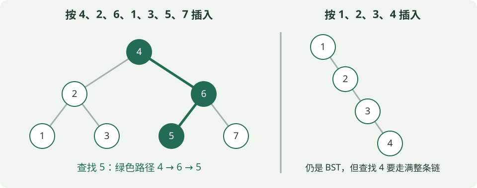

- **查找5：** 比4大→向右到6；比6小→向左到5；相等即找到，共访问3个节点。若走到空位置还未找到，就是查找失败。
- **插入：** 同样沿大小关系走到空位置，再接上新节点。图左由4、2、6、1、3、5、7依次插入得到；中序遍历为1、2、3、4、5、6、7。
- **退化：** 图右依次插入1、2、3、4，每次都往右走。查找4要访问全部4个节点；n个节点时最坏O(n)。查找成本为O(h)，h是树高。

**删除分三种：** 无孩子，直接删；只有一个孩子，让孩子接替它；有两个孩子，用**中序后继（右子树最小值）**或前驱替换，再删除被拿走的那个节点。后继不一定是右孩子，要从右孩子继续一路向左找。

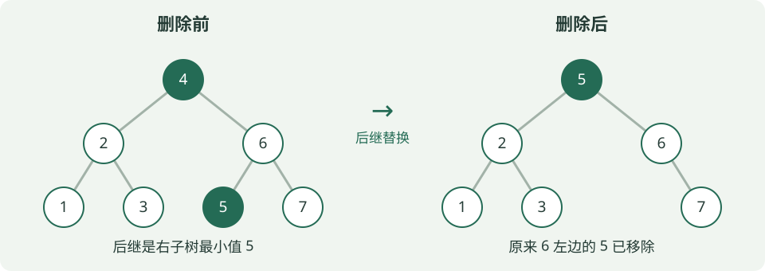

**例题：** 上图删4后，根变为5，6的左孩子变空，中序为1、2、3、5、6、7。对删除前的7节点树，所有键等概率成功查找时，平均访问次数为 $(1\times1+2\times2+4\times3)/7=17/7$：第1层1个节点各需1次，第2层2个各需2次，第3层4个各需3次。

#### AVL：每个节点的两侧高度最多差1

AVL是**带高度平衡约束的BST**。这里空树高度0、叶子高度1，平衡因子 $BF=h_{\text{左}}-h_{\text{右}}$；**每个节点**都必须满足BF∈{−1,0,1}。只看根平衡还不够。

插入时先按BST插入，再从新节点向上找**第一个失衡节点z**。根据从z出发的两步方向，分为下面四类；L是左、R是右，名称表示失衡路径，不是旋转方向。

| 插入失衡类型 | 三个键的最小例子 | 如何修复 |
| --- | --- | --- |
| LL：左孩子的左侧增高 | 30、20、10 | 对z右旋 |
| RR：右孩子的右侧增高 | 10、20、30 | 对z左旋 |
| LR：左孩子的右侧增高 | 30、10、20 | 先对左孩子左旋，再对z右旋 |
| RL：右孩子的左侧增高 | 10、30、20 | 先对右孩子右旋，再对z左旋 |

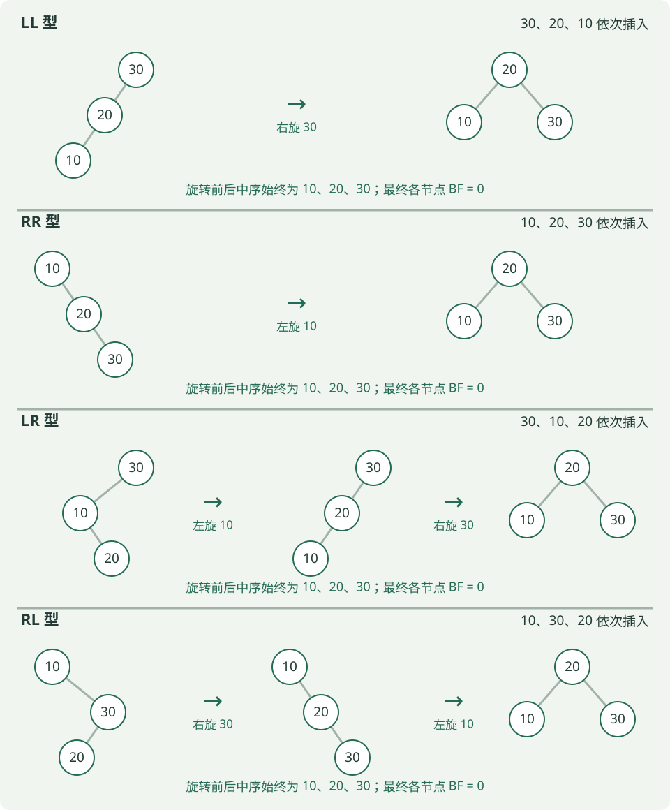

**旋转不是交换键值，而是改连接。** 右旋让左孩子升为子树根，原根下移到右侧；若升上来的节点原有右子树，要交给原根作左子树（左旋完全对称）。这样旋转前后中序顺序不变，仍满足BST。

**例题：** 依次插入30、10、20。插入20后，30左子树高2、右侧空树高0，BF=2；路径30→10→20为LR。先对10左旋，再对30右旋，得到根20、左10、右30，BF均为0。**不是直接对30右旋一次。** AVL的查找、插入、删除最坏均为O(log n)；删除后也要向上检查，可能修复多层。

#### 红黑树：用颜色规则约束树高

红黑树也是BST；它不要求每个节点左右高度差≤1，而是维护下面五条规则：

1. 每个节点为红或黑。
2. 根为黑。
3. **NIL空叶子为黑**：指缺失孩子对应的空节点，不是“存有数据、没有孩子的节点”。
4. 红节点的孩子必须为黑，即不能出现连续两个红节点；黑节点可以连黑节点。
5. 从任一节点到其所有后代NIL的路径，**黑节点数相同**；路径总长度不必相同。

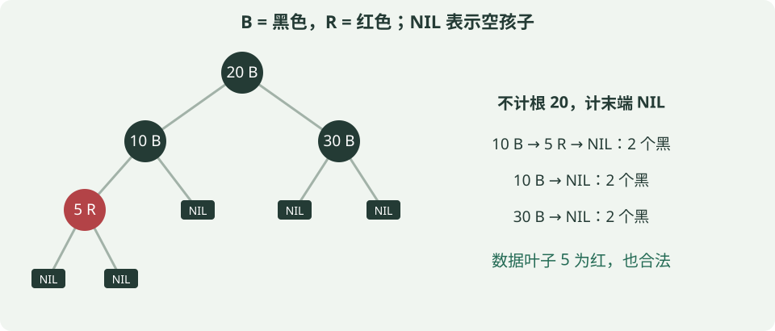

**例题：** 图中约定黑高bh(x)“不计x自身，计末端NIL”。从20走10→5→NIL，黑节点为10、NIL；走10→NIL或30→NIL，也各有2个，所以bh(20)=2。把5改黑，经过5的路径就多一个黑节点，反而不合法。题目采用其他计数约定时，先统一是否计起点和NIL。

**插入怎么调整？** 常见标准红黑树先按BST插入，新节点涂红（不增加路径黑节点数）。父亲为黑则无需修复；父亲为红时，看“叔叔”——父亲的兄弟，空叔叔也算黑：

| 情况 | 调整思路 |
| --- | --- |
| 父红、叔红 | 父与叔变黑，祖父变红；继续向上检查，最后把根变黑 |
| 父红、叔黑，呈LL／RR直线 | 旋转祖父，并交换原父与祖父的颜色 |
| 父红、叔黑，呈LR／RL折线 | 先旋转父亲转成直线，再按上一行处理 |

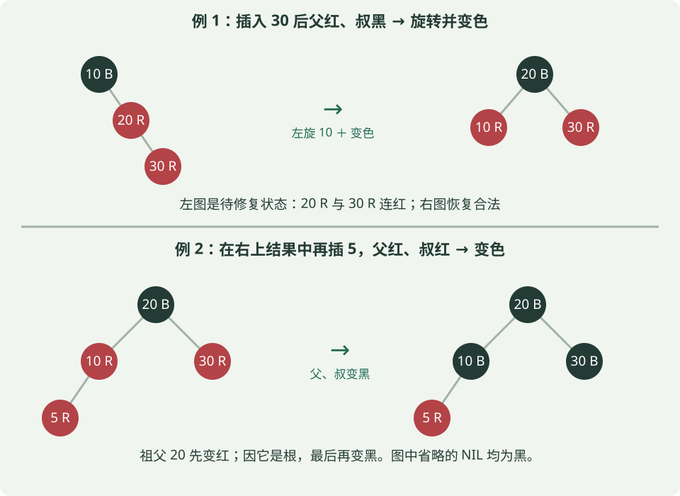

**例题：** 从空树依次插入10、20、30，插30后父20红、叔NIL黑，是RR。对10左旋，20变黑、10变红，最终20黑为根，10和30红为孩子。若在此基础上再插5，则父10与叔30都红，按图下半部分变色即可。

**删除先记住原因：** 按BST删除后，若原位置少了一个黑节点，某些路径的黑节点数就不一致，需要结合替补节点、兄弟及其孩子的颜色，通过变色／旋转恢复；不能把“删除黑节点”当作普通BST直接删完。

#### 三种树的结论放在一起记

| 对比 | 普通BST | AVL | 红黑树 |
| --- | --- | --- | --- |
| 共同规则 | 左子树小、右子树大 | 同左 | 同左 |
| 额外约束 | 无 | 每个节点左右高度差≤1 | 不连红、各条路径黑节点数相等等颜色规则 |
| 最坏查找／插入／删除 | O(n) | O(log n) | O(log n) |
| 调整手段 | 不自动平衡 | 更新高度／BF、旋转 | 变色、旋转 |
| 看图时先检查 | 全部子树大小关系 | 大小关系＋每个节点BF | 大小关系＋颜色＋每条NIL路径 |

**都不要求是完全二叉树，也不要求左右节点数相等。** AVL限制更严格；红黑树用较宽松的规则保证树高仍为O(log n)，不能因此说它退化时查找也是O(n)。只比名称也不能断言谁在所有场景下更快。

本小节方法核对：[Cornell AVL讲义](https://courses.cs.cornell.edu/cs2112/2017fa/lectures/lec_avl/index.html)、[Dartmouth红黑树讲义](https://www.cs.dartmouth.edu/~thc/cs10/lectures/0519/0519.html)。图与数值例题为自编，红黑树采用一般规则，不额外要求红链接左倾。

### ④ 二叉堆：调整过程与Top-k

堆同时满足**完全二叉树的形状**和**父子大小关系**。最小堆父节点不大于孩子，最大堆相反；堆顶是最值，但左右子树和底层数组不必全局有序。以下数组按层序存储、下标从0开始：节点i的孩子为2i+1、2i+2（下标须小于元素数），非根节点的父亲为 $\lfloor(i-1)/2\rfloor$。

插入：先放数组末尾，再与父节点比较并**上浮**。弹出最小值：末尾元素补到根，依次与两个孩子中较小者交换并**下沉**。取顶O(1)，调整O(log n)（不计数组扩容）；自底向上建堆O(n)，逐个插入建堆最坏O(n log n)。

**例题1：** 最小堆 `[2,5,4,9,7,6]` 插入1。先看清：**这个数组按层序记录树，从上到下、每层从左到右；数组里挨着的数，不一定是父子。**

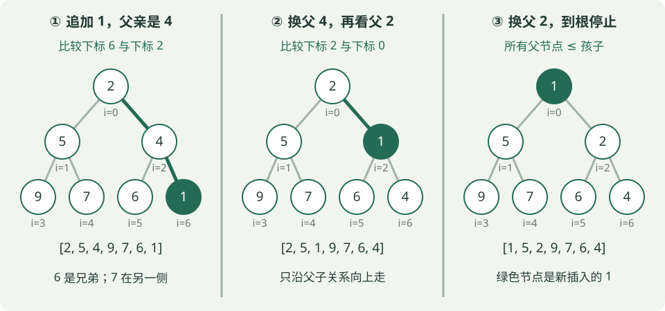

**为什么先与4交换，不从6或7开始？**

1. 先把1追加到下标6，填在4的右孩子位置，保持完全二叉树形状。它的父亲下标为 $\lfloor(6-1)/2\rfloor=2$，而 `a[2]=4`。**6是它的左兄弟，7是5的右孩子**，都不是它的父亲。
2. 最小堆要求“父≤子”。现在4>1，只有新接上的这条父子边违反规则，所以交换1和4：`[2,5,1,9,7,6,4]`。交换的是两个位置上的值，树的连接不变。
3. 1来到下标2，它的新父亲下标为 $\lfloor(2-1)/2\rfloor=0$，值为2。因为2>1，再交换，得到 `[1,5,2,9,7,6,4]`。1已到根，停止。

**记法：插入时沿“新节点→父亲→祖父”上浮，不是从数组末尾逐个向前比较。** 原来的堆已经合法，只需修复这条祖先路径；若中途发现父≤当前值，就可以提前停止，不必每次都升到根。

若从原堆独立地弹出2，先以末尾6补根得 `[6,5,4,9,7]`，与较小孩子4交换，得到 `[4,5,6,9,7]`。两种操作不是把数组直接排序。

**Top-k记法：** 保留最大的k个数，用大小k的**最小堆**；堆顶是当前入选者中最小的“门槛”。堆满后，新数大于门槛才替换。保留最小的k个数则反过来用最大堆。扫描通常O(n log k)（k≥2），额外空间O(k)；若要求最终结果有序，还要排序这k个数。

**例题2：** 从5、1、9、3、8中保留最大的3个：前三个形成最小堆 `[1,5,9]`；3替换1成为 `[3,5,9]`；8替换3成为 `[5,8,9]`。最终第3大是堆顶5。

### ⑤ 哈夫曼树：带权路径长度WPL

**先把权值理解成“出现次数”。** 假设A、B、C、D分别出现2、3、7、9次，想用二叉树给它们编码：每走一条边记一个0或1，根到某字符叶子的路径就是它的编码。路径越长，每次出现就要用越多位；因此希望**出现多的字符少走几步，让总编码长度尽量小**。

**WPL就是“次数×每次要走的步数，再全部相加”：**

$$\mathrm{WPL}=\sum_i w_i\ell_i$$

$w_i$是第i个**原始叶子**的权值，$\ell_i$是从根到该叶子的**边数**。根到孩子算1步，不是把经过的节点个数算进去。权值也可以表示其他成本；这里用出现次数帮助理解。**对于给定的正权值，WPL最小的二叉树称为哈夫曼树**，可按下面的方法构造。

**怎么把树搭起来？每轮选当前最小的两个，给它们加一个共同父节点，父节点值为两者之和；再把这棵子树作为整体放回候选。**

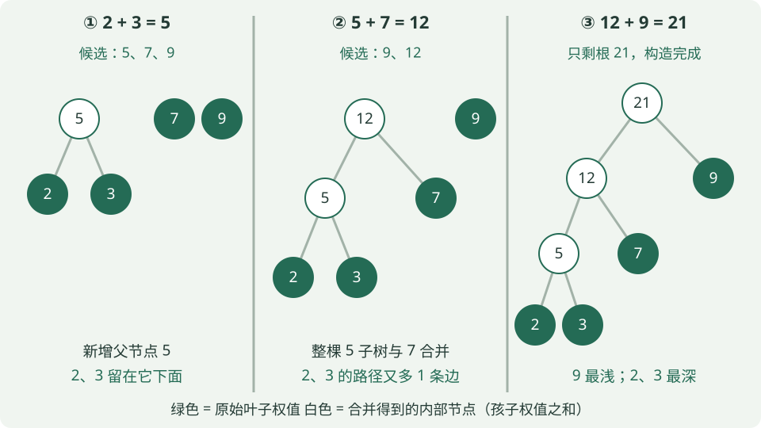

| 轮次 | 合并前的候选权值 | 取最小的两个 | 合并后放回候选 |
| --- | --- | --- | --- |
| 1 | 2、3、7、9 | 2+3=5 | 5、7、9 |
| 2 | 5、7、9 | 5+7=12 | 9、12 |
| 3 | 9、12 | 9+12=21 | 21，只剩一棵树，结束 |

注意：**2、3没有消失，它们仍挂在5下面。** 下一轮拿5去合并，是把整棵子树接上去。新生成的5也必须参与下一轮比较，所以第二轮选5和7，不是继续选原来剩下的7和9。这里不要求BST的“左小右大”。

**对着最终的树算WPL：** 原始权值2、3、7、9是叶子；5、12、21是内部节点，不作为新的叶子另加一遍。

| 原始叶子权值 | 从根到它的路径 | 边数 $\ell_i$ | 对WPL的贡献 $w_i\ell_i$ |
| --- | --- | --- | --- |
| 2 | 21→12→5→2 | 3 | 2×3=6 |
| 3 | 21→12→5→3 | 3 | 3×3=9 |
| 7 | 21→12→7 | 2 | 7×2=14 |
| 9 | 21→9 | 1 | 9×1=9 |

所以 **WPL=6+9+14+9=38**。在字符出现次数的例子中，就是这21次字符出现共需38位编码。若4个字符都放在深度2，则总成本为(2+3+7+9)×2=42；图中把权值9放浅些，虽然2、3变深，总成本却更低。

**为什么也能直接算5+12+21？** 每加一个父节点，它下面的所有原始叶子都比之前多走1条边：

- 合并2和3：两片叶子各多1步，新增成本2+3=**5**。
- 合并5和7：5下面的2、3，以及7都各多1步，新增成本2+3+7=**12**。
- 合并12和9：所有叶子又各多1步，新增成本2+3+7+9=**21**。

因此 **WPL=所有合并结果之和=5+12+21=38**。这和上表是同一笔成本的两种算法，不能再把两种结果相加。根权值21只表示原始权值的总和，不是WPL。

**做题记住：** 每次取当前最小的两个→合并后放回→累加每次的合并值。左右孩子互换不改变深度和WPL；若约定左边0、右边1，则会改变具体编码。图中权值9的编码为1，权值2的编码为000，正好分别是1位、3位。

### ⑥ 图：度数、存储与BFS／DFS

这一小节始终用同一张图：5个顶点A、B、C、D、E，5条**无向边AB、AC、BD、CE、DE**。无向边AB可以从A走到B，也可以从B走到A；若是有向边A→B，则只能按箭头方向走。

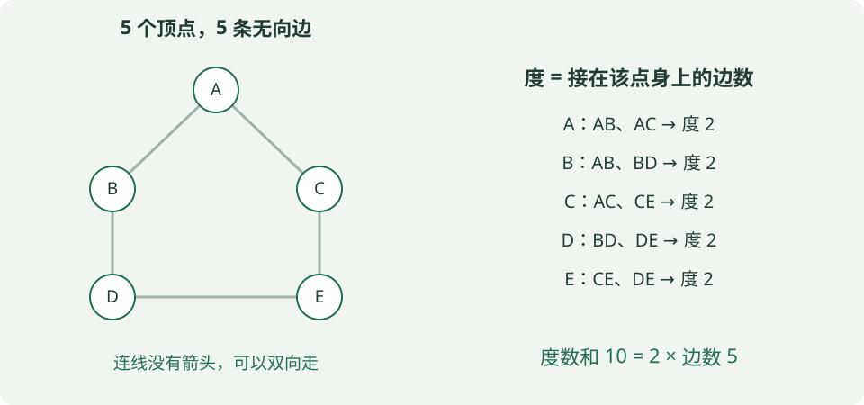

#### 先看懂“度”和“边数”在数什么

**顶点的度，就是有几条边接在它身上。** 例如A连着AB、AC，所以度为2；这张图的5个顶点度都为2。度数和是10，但边只有5条：每条无向边都在两个端点各被数了一次，所以 **度数和=2E**。V表示顶点数，E表示边数。

有向图要分开数：箭头进入一个点，记它的**入度**；从它出发，记它的**出度**。例如只有A→B、A→C时，A出度2、入度0，B和C各入度1；每条边贡献一次出度、一次入度，所以**入度和=出度和=E**。

| 条件 | 最多有多少条边 | 为什么 |
| --- | --- | --- |
| 简单无向图 | $V(V-1)/2$ | 每个点最多连其余V−1个点，但AB与BA是同一条边，要除以2 |
| 简单有向图，允许相反方向各一条 | $V(V-1)$ | 每个点可向其余V−1个点连边，A→B与B→A是不同边 |

“简单图”在这里指无自环、无重边：自环是A连自己，重边是同一连接重复出现。上面的图有5条边，却有环A→B→D→E→C→A，所以**图不一定是树**；图也不一定连通。

**例题：** 6个顶点的简单无向图，度数和14，则E=14/2=7；最多边数6×5/2=15。7条边不能保证连通，例如4个顶点两两相连有6条边，另2个顶点单独相连再添1条边，仍分成两块。

#### 同一张图，如何存进计算机？

**邻接表：给每个顶点列一份“直接邻居名单”。** 上图可以存成：

```text
A: B, C
B: A, D
C: A, E
D: B, E
E: C, D
```

AB虽只有一条边，但A的名单写B、B的名单也写A，因此无向边在常规邻接表中存两份。本例是5份名单、10个邻居条目；一般空间为O(V+2E)，也就是**O(V+E)**。这里的邻居指“一步能到”，不是所有可达的点。

**邻接矩阵：用一张V×V的表，记录任意两个点是否直接相连。** 本例1表示有边，0表示无边：

| 行→列 | A | B | C | D | E |
| --- | --- | --- | --- | --- | --- |
| A | 0 | 1 | 1 | 0 | 0 |
| B | 1 | 0 | 0 | 1 | 0 |
| C | 1 | 0 | 0 | 0 | 1 |
| D | 0 | 1 | 0 | 0 | 1 |
| E | 0 | 0 | 1 | 1 | 0 |

例如第A行、第B列为1，对应AB；第A行、第E列为0，表示没有直接边AE，**不代表A走不到E**。无向图的矩阵对称，无自环时对角线为0。无论实际有多少边，都保留V²个格子，所以空间**O(V²)**。

**例题：** 查A与E是否直接相连，矩阵直接看一个格子即可；用普通邻接表则检查A的邻居名单。若要列出A的全部邻居，邻接表只读B、C两个条目，矩阵则需扫描A行的5个格子。

#### BFS：先走完近的一层，用队列记“待处理的人”

下面约定从A出发，**每个点的邻居按字母升序检查**。`visited`表示“已经发现过”，BFS在**入队时就标记**，避免同一个点被重复加入队列。队列先进先出，左端出队、右端入队。

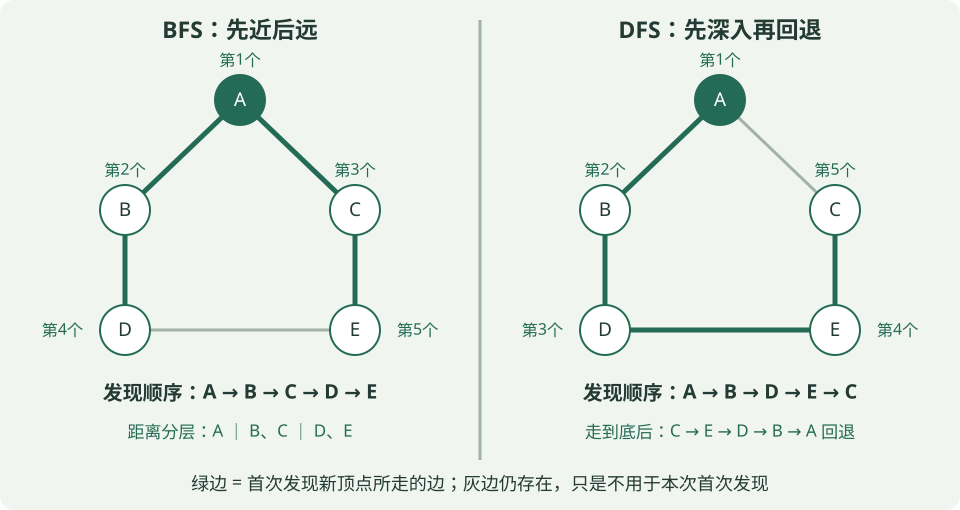

| 取出谁处理 | 按字母顺序检查邻居，发生什么 | 处理后的队列（左边先出） |
| --- | --- | --- |
| 初始化 | 发现A，标记并入队 | [A] |
| A | B、C都未发现，依次标记入队 | [B, C] |
| B | A已发现，跳过；D未发现，入队 | [C, D] |
| C | A已发现，跳过；E未发现，入队 | [D, E] |
| D | B、E都已发现，均跳过 | [E] |
| E | C、D都已发现，均跳过 | []，结束 |

所以首次发现顺序为 **A、B、C、D、E**。尤其注意处理D时，E虽然还没出队，但已经被C发现并入队，不能再入队一次。

**为什么能求最少边数？** 从A出发，第0层是A，第1层是B、C，第2层是D、E。队列让第1层处理完才轮到第2层，因此不会漏掉更短的路线。首次发现E的是C，沿发现关系回溯得到 **A→C→E，共2条边**。这适用于无权图，或所有边权相同且为正的情况；边权不同时不能用层数代替总权重。

**例题提醒：** 遍历顺序ABCDE表示“先后访问了谁”，不表示一条A→B→C→D→E的路线——图中甚至没有BC这条边。路径要沿实际存在的边走。

#### DFS：选一条路深入，走不动再退回来

递归DFS进入一个点时就标记访问，再依次递归访问尚未访问的邻居。仍从A出发、按字母升序检查邻居：

1. A的邻居是B、C，先选B；**C留到返回A后再检查**。
2. 到B，跳过已访问的A，进入D。
3. 到D，跳过B，进入E。
4. 到E，邻居C、D中先看C，它未访问，进入C。
5. 到C，A、E都已访问，无路可继续，于是沿递归调用**退回E→D→B→A**。回到A时，C已在刚才的深入过程中访问过，也跳过，结束。

首次访问顺序为 **A、B、D、E、C**；回退经过旧节点，不把它再次记进访问序列。递归调用栈记住“从谁那里来、返回后继续检查谁”，也可以用显式栈实现。

**对比例题：** DFS第一次到E沿A→B→D→E走了3条边；BFS找到A→C→E只需2条边。DFS关注“先深入”，所以首次找到的路径不保证最短。图有环，若没有visited，就可能沿环不断重复走。

**最后记住两个边界：** 不指定邻居顺序时，BFS／DFS序列可能不唯一，但BFS求出的最少边数距离不变；从一个起点只遍历可达部分，若要遍历整张非连通图，需要再从未访问顶点启动。

| 完整遍历的存储方式 | BFS／DFS的时间复杂度 | 成本来自哪里 |
| --- | --- | --- |
| 邻接表 | O(V+E) | 每个顶点处理一次，每个邻居条目检查一次；无向边检查两次不改变数量级 |
| 邻接矩阵 | O(V²) | 每个顶点都要扫描整行的V个格子，找出邻居 |

### ⑦ 最短路：Dijkstra如何手算

边权不同时，路径代价是**沿途边权之和**。Dijkstra适用于所有边权非负的图。先令起点距离0、其余为无穷；每轮选尚未确定的节点中距离最小者u，再尝试经u更新邻居v：

$$d[v]\leftarrow\min(d[v],\ d[u]+w(u,v))$$

d[v]是目前找到的起点到v的最小代价，w(u,v)是边u→v的权值。“松弛”就是比较原路线与“先到u、再走到v”哪条更短。**不是只挑眼前最小的一条边。** 一般含负权图不能直接套Dijkstra；可考虑Bellman–Ford，且从源点可达的负环会使受其影响的节点不存在有限最短距离。

**例题：** 有向边S→A(4)、S→B(1)、B→A(2)、A→T(1)、B→T(5)，求S到T的最短距离。

| 本轮确定的节点 | 更新后的d[A] | d[B] | d[T] |
| --- | --- | --- | --- |
| S，距离0 | 4 | 1 | 无穷 |
| B，距离1 | min(4,1+2)=3 | 1 | 1+5=6 |
| A，距离3 | 3 | 1 | min(6,3+1)=4 |
| T，距离4 | 3 | 1 | 4 |

所以路径 **S→B→A→T，总代价4**。直接按BFS取边数少的路线可能选S→A→T，代价5，不能解决本题。

### ⑧ 最小生成树：连接所有点的最小总边权

**先分清三个名称：MST是要找的结果，Kruskal和Prim是求这个结果的两种算法。** MST不是一个“包含两套步骤”的算法；Kruskal和Prim都可以独立求出最小生成树，不需要先做一种再做另一种。

| 名称 | 是什么 | 一句话理解 |
| --- | --- | --- |
| MST（最小生成树） | 目标／结果 | 连接全部顶点、无环且总边权最小的树 |
| Kruskal | 求MST的一种算法 | 按边权从小到大选边，跳过会成环的边 |
| Prim | 求MST的另一种算法 | 从一个点开始，每次用最便宜的跨界边接入一个新点 |

**读题时：** 只说“求MST”，通常可以任选一种算法；若指定Kruskal或Prim，就按指定算法展示过程。两种算法得到的树可能不同，但最小总权重相同；如果MST唯一，最终选中的边也相同。

**想象给A、B、C、D四个地点铺通信线路。** 图中的边表示可选线路，边权表示铺设费用。要求任意两地能通过线路互通，可以经过其他地点；不要求每两地之间都铺一条直连线。我们要从原图中选出一棵**覆盖全部地点、总费用最小的树**，这就是最小生成树（Minimum Spanning Tree，MST）。

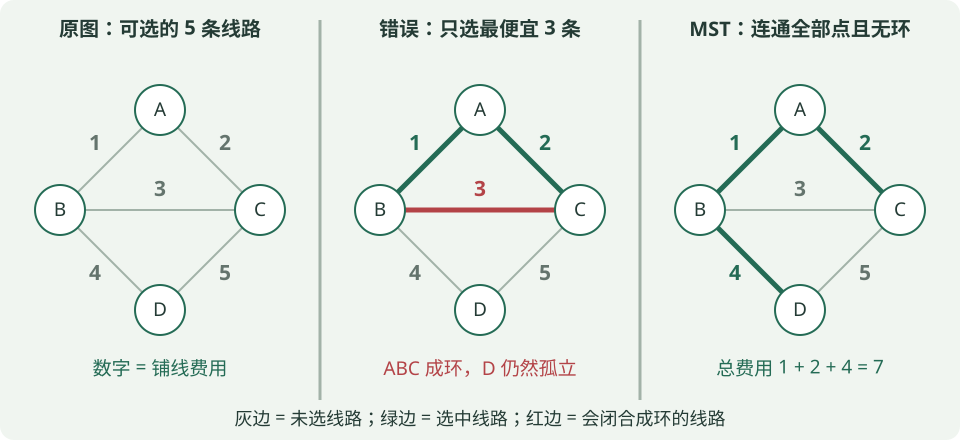

#### “生成树”和“最小”分别要求什么？

- **生成树：** 保留原图的全部V个顶点，从原图选边，使它们连通且无环。因此恰有V−1条边。上图有4个点，生成树应选3条边。
- **最小：** 在所有生成树中，所选边权之和最小。不是边数更少——每棵生成树本来就有V−1条边。
- **不能只挑最便宜的V−1条边：** AB、AC、BC虽然最便宜，但在A、B、C之间成环，D还没接进来，不是一棵生成树。

对铺线费用为正的例子，环上删掉一条边仍然连通，还能省钱。**但“无环”本身就是生成树的定义**；即使题目允许负权，也仍要选树，不能为了降低费用把负权环全留下。

#### Kruskal：把所有边排序，能连接两块就选

先把每个顶点看成独立的一块，再按边权从小到大检查。**两端已通过选中的边连通，就跳过；两端仍在不同块，就加入并合并两块。** 因为两端之间已有路径时，再加一条边会闭合成环。程序中常用并查集检查两端是否属于同一块。

**例题：** 仍用上图，排序后为AB(1)、AC(2)、BC(3)、BD(4)、CD(5)。

| 考察的边 | 为什么选／不选 | 已选边形成的连通块 | 累计权重 |
| --- | --- | --- | --- |
| 初始 | 尚未选边 | {A}、{B}、{C}、{D} | 0 |
| AB(1) | A、B在不同块，选 | {A,B}、{C}、{D} | 1 |
| AC(2) | A、C在不同块，选 | {A,B,C}、{D} | 3 |
| BC(3) | 已有B→A→C，再加BC会成环，跳过 | {A,B,C}、{D} | 3 |
| BD(4) | 把D接入已有的ABC，选 | {A,B,C,D} | 7 |

已选满V−1=3条边，结束，不必再考察CD。结果是 **AB、AC、BD，总权重1+2+4=7**。判断成环看的是“是否已有一条路径”，不只是检查有没有同一条直接边。

#### Prim：从一个点长出一棵树，每次接入一个新点

设S是已经接入的顶点集合。每轮只在**一端在S、另一端不在S**的边里选最便宜的一条，再把外面的端点加入S。两端都在S会成环，两端都在S外则接不上当前这棵树。

**例题：从D出发。** 特意换个起点，看看Prim与Kruskal选择边的先后有什么不同：

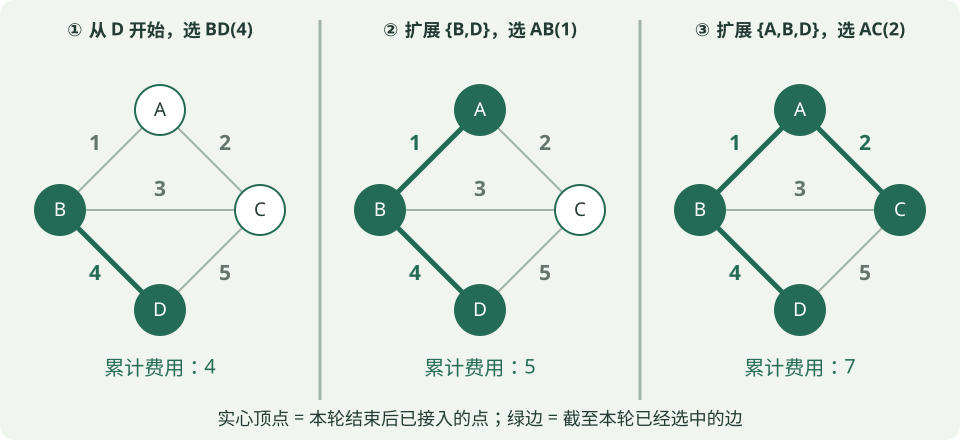

| 本轮开始的S | 合法候选：一端在S、一端在外 | 选哪条，为什么 | 新的S |
| --- | --- | --- | --- |
| {D} | BD(4)、CD(5) | 选BD(4)；AB(1)虽更便宜，但两端都没接进来 | {B,D} |
| {B,D} | AB(1)、BC(3)、CD(5) | 选AB(1) | {A,B,D} |
| {A,B,D} | AC(2)、BC(3)、CD(5) | 选AC(2)，接入最后一个点C | {A,B,C,D} |

总权重仍为 **4+1+2=7**。Prim每次看的是**整个S的边界**，不是只从“刚加入的那个点”往外挑。它的选边权重也不要求递增：这里就是4、1、2。

**两种方法为什么敢选便宜边？** 可以把图切成“已经连成的一块”和“外部”两侧。任何生成树都必须有边跨过这个分界；选择跨界的最轻边是安全的：若某棵MST没有它，加上它会形成环，环上必有另一条跨界边，可用这条不更贵的边替换。Prim直接找S边界上的最轻边；Kruskal的排序与判环也保证每次加入的边满足这一安全条件。

#### 最小生成树为什么不等于最短路？

仍看同一张图：**原图C到D有直接边CD，距离5；MST中却要走C→A→B→D，距离2+1+4=7。** MST为了让铺设的线路总费用最低，舍弃了CD；它不保证每两点之间的行程最短。

| 做题时比较 | Kruskal | Prim |
| --- | --- | --- |
| 每轮怎么选 | 所有边按权重排序，跳过成环边 | 在当前S与外部之间选最轻边 |
| 中途是什么形状 | 可以是多个分散的连通块，逐渐合并 | 始终是一棵连通的树，逐渐长大 |
| 常见实现复杂度 | 排序＋并查集，通常O(E log E) | 邻接矩阵O(V²)；邻接表＋二叉堆常见O((V+E) log V) |

**选择题结论：** 这里讨论无向带权图；负权不妨碍Kruskal／Prim。若原图不连通，就没有覆盖全图的一棵生成树，可分别求各块的最小生成树，合起来叫“最小生成森林”。所有边权互异时MST唯一；有相等边权时可能唯一，也可能不唯一，但所有MST的总权重相同。

### ⑨ 拓扑排序：依赖先后与判环

有向边u→v表示u必须先于v。拓扑序须满足**每条边的起点都排在终点之前**；有向图存在拓扑序，当且仅当它无有向环（DAG）。算法可反复选入度为0的节点，输出并删除它的出边，让相应邻居入度减1。还有节点却找不到入度0者，说明有环。多个节点同时可选时，可能有多种合法序列。

**例题：** 只有边A→C、B→C、C→D。开始可选A或B，但二者都完成后C才可选，D必须在C之后，因此仅有 **ABCD、BACD** 两种拓扑序。ACBD不合法，因为B必须在C前。若再加D→A，出现A→C→D→A的环，就不存在拓扑序。

**题源与方法依据：** 公开题型示例包括[叶子节点计数](https://www.nowcoder.com/questionTerminal/95e7a9ae42624c4cbe74a1889d513c4a)、[最小堆插入调整](https://m.nowcoder.com/questionTerminal?from=&fromPut=&uuid=e679114ac6c743c5a628af3494225947)、[拓扑排序](https://www.nowcoder.com/questionTerminal/88f7e156ca7d43a1a535f619cd3f495c)。概念核对使用[OpenDSA二叉树性质](https://opendsax.cs.vt.edu/OpenDSA/Books/Everything/html/BinaryTreeFullThm.html)、Princeton的[BST](https://algs4.cs.princeton.edu/code/javadoc/edu/princeton/cs/algs4/BST.html)、[堆](https://algs4.cs.princeton.edu/24pq/)、[Huffman](https://algs4.cs.princeton.edu/code/edu/princeton/cs/algs4/Huffman.java.html)、[图算法](https://algs4.cs.princeton.edu/cheatsheet/)、[最短路](https://algs4.cs.princeton.edu/44sp/index.php)、[MST](https://algs4.cs.princeton.edu/43mst/index.php)、[拓扑排序](https://algs4.cs.princeton.edu/42digraph/)。这些资料支持题型与方法，不构成阿里实际考频统计；本节数值例题及新增练习均为自编。

## 9. 排序、稳定性与二分的常见坑

**稳定排序**保留相同关键字元素原来的相对顺序。例如 `[2甲,1,2乙]` 按数字升序稳定排序后应为 `[1,2甲,2乙]`；甲、乙只是区分两个同值元素，不参与比较。稳定不代表“速度稳定”，也不代表“原地”。原地通常指只使用常数级辅助存储；递归算法还要单独考虑调用栈。

下面都按**升序排列数组 `[4,2,1,3]`**，看四种算法各自在做什么。

### ① 快速排序：先选基准，把两侧分开

选一个数作**基准pivot**，通过分区把小的移到左边、大的移到右边，再递归处理左右两部分。下面采用一种常见分区方式：**取末尾元素作基准，扫描时把小于等于基准的元素交换到左侧，最后把基准放到两部分之间。**

**例题：** 基准取3。从左到右扫描：4>3，先不动；2≤3，将2与左侧的4交换；1≤3，再将1与4交换；最后交换4与基准3：

```text
开始：          [4,2,1,3]    基准是末尾的3
把2换到左侧：   [2,4,1,3]
把1换到左侧：   [2,1,4,3]
把基准放中间：  [2,1] | 3 | [4]
递归排左侧：    [1,2] | 3 | [4]
```

一次分区只保证两侧与基准的大小关系，**两侧内部还不一定有序**，例如上面的 `[2,1]`。不同分区实现可能产生不同中间数组，手算题应按题设的基准和交换规则。

**复杂度与稳定性：** 一轮扫描O(n)，划分较均衡时约有log n层，平均O(n log n)。若每次都分成0和n−1个元素，就要扫描n、n−1、n−2……，最坏O(n²)。例如升序数组总选末尾最大值就可能退化。普通递归实现的栈空间平均O(log n)、最坏O(n)；原地交换分区通常**不稳定**，远距离交换可能颠倒同值元素的先后。随机选基准能降低坏划分的风险，不代表最坏情况消失。

### ② 归并排序：先拆成小段，再合并有序段

把数组不断分成两半，直到每段只有一个元素；单元素天然有序。然后逐层**合并两个有序段**：比较两段当前最前面的元素，把较小者放进结果，再移动对应指针。

**例题：**

```text
拆分： [4,2,1,3] → [4,2] [1,3] → [4] [2] [1] [3]
合并： [4]与[2] → [2,4]；[1]与[3] → [1,3]
最后： [2,4]与[1,3] → [1,2,3,4]
```

最后一次合并具体是：比较2和1，取1；比较2和3，取2；比较4和3，取3；右段耗尽，把左段剩下的4接上。**不是把两个有序段直接拼接。**

**复杂度与稳定性：** 拆分约log n层，每层合并共处理n个元素，所以平均、最坏均O(n log n)。常见数组实现需要O(n)辅助数组。合并时遇到相等值**先取左段的元素**，就能保持原先顺序，实现稳定排序；若总先取右段，相等元素就可能被颠倒。

### ③ 堆排序：反复把最大的数放到末尾

升序的常见原地堆排序先建**最大堆**，让堆顶是当前最大值。然后把堆顶与未排序区最后一个元素交换，缩小堆的范围，再让新堆顶下沉恢复最大堆。**右边排好的部分不再参与堆调整。**

**例题：** 数组按层序存储，竖线右边表示已排好的后缀。

```text
原数组：                [4,2,1,3]
自底向上建最大堆：      [4,3,1,2]       2与孩子3交换
将堆顶4换到末尾：       [2,3,1 | 4]
剩余部分恢复最大堆：    [3,2,1 | 4]
将堆顶3换到未排序区末尾：[1,2 | 3,4]
剩余部分恢复最大堆：    [2,1 | 3,4]
再将堆顶2换到末尾：     [1 | 2,3,4]     完成
```

**复杂度与稳定性：** 自底向上建堆O(n)，之后反复取顶并下沉，每轮最多O(log n)，总时间平均、最坏均O(n log n)。使用迭代下沉时额外空间O(1)。堆顶与末尾的远距离交换可能改变同值顺序，因此通常**不稳定**。

**容易混淆：** 要取最小值可以用最小堆；但这里是把取出的数直接放在数组右端，所以升序用最大堆，把最大的先放到最右边。

### ④ 插入排序：维护左侧有序区，把新数插进去

像整理手里的扑克牌：左侧已经有序，每次拿出右侧的第一个数，将左侧**比它大的数逐个右移**，空出位置后插入。不是只交换一次就结束。

**例题：** 竖线左边是已排好的前缀。

```text
开始：     [4 | 2,1,3]
插入2：    [2,4 | 1,3]     4右移，2放到前面
插入1：    [1,2,4 | 3]     4、2依次右移，1放到前面
插入3：    [1,2,3,4 | ]    4右移，遇到2≤3就停止
```

**复杂度与稳定性：** 平均、最坏O(n²)；逆序时第2个元素要越过1个数，第3个越过2个……，共约n(n−1)/2次移动。已有序时，每次发现前一个数不大于当前数便停止，最好O(n)，因此适合小规模或接近有序的数据。额外空间O(1)。只移动**严格大于**当前值的元素，不跨过相等元素，就能保持稳定。

### 四种排序的速记对照

| 常见实现 | 平均时间 | 最坏时间 | 额外空间 | 稳定性 |
| --- | --- | --- | --- | --- |
| 快排 | $O(n\log n)$ | $O(n^2)$ | 普通递归栈平均O(log n)，最坏O(n) | 通常不稳定 |
| 数组归并 | $O(n\log n)$ | $O(n\log n)$ | O(n) | 相等时先取左段，可稳定 |
| 堆排序 | $O(n\log n)$ | $O(n\log n)$ | 迭代调整O(1) | 通常不稳定 |
| 插入排序 | $O(n^2)$ | $O(n^2)$ | O(1) | 只右移严格更大元素，可稳定；已有序时O(n) |

**四句记法：** 快排“基准分两边”；归并“拆开再合并”；堆排序“最大值送末尾”；插入排序“新元素插进有序前缀”。这里讲常见实现，特殊变体和库实现按题设。

二分查找还要注意边界：在升序数组 `[1,2,2,4]` 中，找“第一个不小于2的位置”应返回下标1（从0开始），而找“任意等于2的位置”可以返回1或2，二者目标不同。

## 10. 进程、线程、锁与死锁

**进程**通常有独立地址空间；同进程的线程共享许多进程资源，但各有自己的栈和执行上下文。线程共享数据方便，也需要同步；“线程有自己的栈”不代表线程间完全没有共享内存。

**互斥锁**让某段共享资源操作同一时刻只被一个持锁者执行。**信号量**可表示资源数量，P／wait申请，V／signal释放。资源计数与互斥是不同需求。

**死锁**是多个执行者相互等待，无法推进。例：线程甲持锁A等锁B，乙持锁B等锁A。统一加锁顺序可破坏这种循环等待；不能声称一把锁或一个超时解决所有并发问题。

生产者消费者中，生产者先等空位，再取互斥锁；消费者先等产品，再取互斥锁。若先持互斥锁再等待空位／产品，可能把能满足条件的对方挡住。

## 11. TCP、HTTP、数据库与缓存的基础判断

### ① TCP：字节流、确认号与两个窗口

先分层：**HTTP规定请求、响应的含义，是应用层协议；TCP负责把字节可靠、有序地送到对端，是传输层协议。** TCP面向连接、全双工；UDP按数据报传输，保留报文边界，本身不提供TCP式的可靠重传与按序交付。

**“字节流”是什么意思？** 发送方先send `ABC`，再send `DE`，接收方可能分两次读到 `AB`、`CDE`，也可能一次读到 `ABCDE`。字节顺序保持，但应用的两条消息边界不由TCP保存。因此需要长度前缀、分隔符或明确的协议格式分帧；不能靠“一次recv就是一条消息”。

**序号seq按字节编号，确认号ack表示“下一个期望收到的字节”。** 收到连续的1000～1099号字节，ack应为1100。若中间缺了一段，即使后面的字节已到达，累计确认号也不能越过缺口。TCP借助确认、重传、校验和与接收端排序等机制实现可靠传输；收到TCP ACK不等于对方应用已经完成下单或写库。

| 机制 | 保护谁／解决什么 | 做题抓手 |
|---|---|---|
| 流量控制，接收窗口rwnd | 接收方来不及接收，避免缓冲区被撑满 | 看接收方还能容纳多少字节 |
| 拥塞控制，拥塞窗口cwnd | 网络承载不了，避免持续向拥塞网络猛发 | 看网络反馈；经典算法含慢启动、拥塞避免等 |

简化题中，可在途的未确认数据上限是 `min(rwnd, cwnd)`；**还能新增发送的量，要再减去已经在途的量**。两种窗口不是相加。经典慢启动在理想连续确认下约每RTT翻倍，拥塞避免约每RTT增加一个MSS；具体题目若给定算法／ACK规则，按题设计算，别把所有实现都套成同一条增长曲线。

**例题：** A发出seq=1000、载荷长度200字节的数据段，B完整且按序收到，之前无缺口，则ack=1200。若rwnd=8000字节、cwnd=5000字节，已有3000字节在途，最多再发 `min(8000,5000)−3000=2000` 字节。

依据：[TCP标准RFC 9293](https://www.rfc-editor.org/rfc/rfc9293.html)、[经典拥塞控制RFC 5681](https://www.rfc-editor.org/rfc/rfc5681.html)。

### ② 三次握手、四次挥手：为什么要来回确认

**握手要交换并确认双方的初始序号。** 下表假设不携带应用数据，客户端初始序号100，服务端初始序号500：

| 次数 | 方向与报文 | 意义 |
|---|---|---|
| 1 | 客户端 → 服务端：SYN，seq=100 | 客户端申请连接，告诉对方自己的起始序号 |
| 2 | 服务端 → 客户端：SYN+ACK，seq=500，ack=101 | 确认客户端的SYN，同时发送自己的起始序号 |
| 3 | 客户端 → 服务端：ACK，seq=101，ack=501 | 确认服务端的SYN；服务端收到后完成正常握手 |

**SYN和FIN各消耗一个序号；没有载荷的纯ACK不消耗序号。** 第二次不能作为最后一步，因为服务端还没收到对方对自己SYN的确认。这里的“可靠”也不等于三次握手能解决所有网络故障。

**关闭连接要分别关闭两个发送方向。** 常见过程是：A发FIN表示“我不再发”；B先ACK确认，但可能还有数据要发；B发完后再发自己的FIN；A最后ACK。B的ACK与FIN可以合并，所以并非每次关闭都恰好四个包。A发FIN后仍可继续接收B的数据，这就是半关闭。

正常主动关闭的一方通常进入**TIME_WAIT**，典型等待2MSL（两倍最大报文生存时间）：既能在对方重发FIN时再次确认，也给旧连接的迟到报文留出消失时间。**CLOSE_WAIT**表示已收到对方FIN，正在等本地应用关闭；大量CLOSE_WAIT要关注本地连接是否及时关闭，别与TIME_WAIT混淆。

**例题：** A发出seq=3000、不带数据的FIN，B确认号应为3001，而不是3000。若题设MSL=30秒，则2MSL=60秒；不能把某个系统的实际配置当成通用常数。

### ③ HTTP：方法、状态码与缓存验证

HTTP请求通常表达“用什么方法访问哪个资源”，响应包含状态码、字段和可能存在的内容。**无状态**指协议本身不要求每次请求自动继承上次业务会话；网站仍可借助Cookie、会话或令牌维持登录。它也不表示每次请求都要新建连接。

| 方法 | 常见语义 | 安全／幂等（按标准语义） |
|---|---|---|
| GET／HEAD | 获取资源表示；HEAD不返回响应内容 | 安全、幂等 |
| POST | 把内容交给目标资源处理，如创建订单 | 不保证安全或幂等 |
| PUT | 用请求内容创建／替换指定资源的状态 | 不安全、幂等 |
| DELETE | 删除目标资源的关联 | 不安全、幂等 |

这里的“安全”指没有请求修改资源状态的语义，**不代表数据经过加密**；“幂等”看重复请求的预期效果，不要求每次状态码相同。第一次DELETE返回成功、第二次返回404，仍可以幂等。POST也能通过业务幂等键实现重复扣款防护，但不是方法本身自动保证。

| 状态码 | 题目中怎样理解 |
|---|---|
| 200／201／204 | 成功／创建成功／成功但无响应内容 |
| 301／302；307／308 | 永久／临时重定向；307／308明确保留原请求方法，301／302可能把POST转GET |
| 304 | 条件请求确认缓存表示未修改，可复用已有内容；不是“返回完整新页面” |
| 400／401／403／404 | 请求有误／缺少有效认证凭证／拒绝访问／未找到资源 |
| 500／502／503 | 服务器内部错误／网关收到无效上游响应／服务暂不可用 |

方法和状态码依据：[HTTP语义RFC 9110](https://www.rfc-editor.org/rfc/rfc9110.html)。

**缓存题按“能否直接用 → 是否需要验证”判断。** 响应允许缓存且仍新鲜时，可直接复用；过期后可带 `If-None-Match`（对应ETag）或 `If-Modified-Since`（对应Last-Modified）发条件请求。未变化通常返回304；变化则返回200和新内容。

- `max-age=60`：按缓存年龄判断60秒的新鲜期，不是永久有效。
- `no-cache`：可保存，但再次使用前必须成功验证。
- `no-store`：要求不要存储，和no-cache不是一回事。

**例题：** 简化假设刚收到响应时缓存年龄为0，响应有 `max-age=60`、ETag=`"v1"`。20秒后可直接复用；70秒后带 `If-None-Match: "v1"` 验证，资源未变则用304配合本地旧内容。这里304省掉完整内容传输，仍有一次网络验证。

缓存依据：[RFC 9111](https://www.rfc-editor.org/rfc/rfc9111.html)。

### ④ HTTP/1.1、HTTP/2、HTTP/3：多路复用解决了哪一层

| 版本 | 连接与传输 | 重点区别 |
|---|---|---|
| HTTP/1.1 | TCP；默认持久连接，可复用连接发多次请求 | 管线化请求的响应必须按请求顺序返回，前一个慢响应会挡住后面的响应 |
| HTTP/2 | TCP；将消息拆成二进制帧，以流编号区分请求 | 同一连接可交错传输多个流；HPACK压缩头字段；仍受TCP按序交付约束 |
| HTTP/3 | QUIC（基于UDP） | QUIC提供可靠流与加密；独立流不必因其他流缺失的数据而等待同一条TCP字节流补齐；头字段使用QPACK |

**先区分“复用连接”和“多路复用”。** HTTP/1.1长连接是反复使用同一条连接；HTTP/2可把A、B两个响应拆成帧交错发送，B无需等A完整结束才能推进。

但HTTP/2的这些帧仍装在**同一条TCP有序字节流**里。前面一段字节丢了，后面属于B的字节即使到达，也可能要等缺口补齐才能向HTTP层交付。这就是它仍有**TCP层队头阻塞**的原因。HTTP/3避免这种跨流的传输层按序等待；丢失某个流的数据仍会阻塞该流，连接级拥塞控制等也仍可能影响其他流，不能记成“HTTP/3永不阻塞”。

**HTTPS是HTTP的安全传输。** HTTP/1.1、HTTP/2的HTTPS通常是HTTP＋TLS＋TCP；HTTP/3由QUIC集成TLS 1.3握手。TLS负责加密、完整性和身份认证；HTTP版本升级不等于业务请求自动获得授权。

**例题（假设场景）：** 浏览器同时发出两个请求：**请求A下载一张图片，请求B获取一份JSON数据**，两者复用同一条HTTP/2连接。这里A、B是请求的代号，不是讲义中的图号。

**问题：** 如果承载A响应的某段TCP数据丢失，B的响应一定完全不受影响吗？

**解答：不一定。** 假设丢失的数据在TCP字节流中排在B的数据之前，即使后面的B数据已经到达，TCP也需要等前面的缺口补齐，才能按序向HTTP层交付。因此，HTTP/2虽然允许不同流的帧交错传输，仍可能受到TCP层队头阻塞的影响。

**易错判断：** “HTTP/2消除了HTTP/1.1管线化的响应顺序限制”可以成立；“HTTP/2消除了所有层面的队头阻塞”则不成立，要看题目说的是哪一层。

依据：[HTTP/1.1 RFC 9112](https://www.rfc-editor.org/rfc/rfc9112.html)、[HTTP/2 RFC 9113](https://www.rfc-editor.org/rfc/rfc9113.html)、[HTTP/3 RFC 9114](https://www.rfc-editor.org/rfc/rfc9114.html)。

### ⑤ B-tree：一个节点放多个键，降低树高

**B-tree（B树）是平衡的多路搜索树，不是二叉搜索树BST。** BST一个节点通常放一个键，分左右两个方向；B-tree一个节点可放多个排好序的键，把取值分成多个区间。所有叶子在同一层，节点有最低占用要求，避免树变成长链。

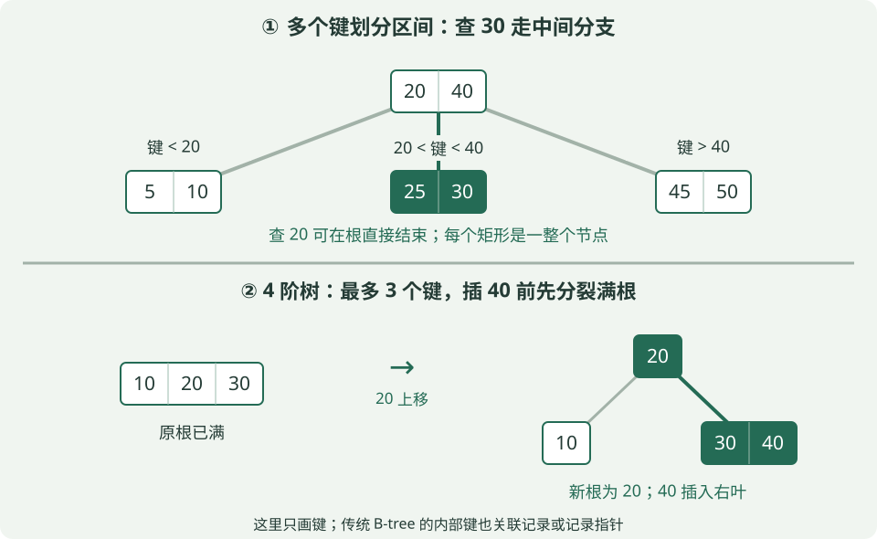

**看上半图查30：** 根是 `[20 | 40]`，30在20与40之间，沿中间指针到 `[25 | 30]` 即可找到。查20则可直接在根命中；传统B-tree的内部节点也可保存记录或记录指针。一次访问一个节点不等于只做一次键比较。

**为什么适合磁盘索引？** 一个节点通常对应一个存储页，读一次页就能拿到一组键并确定下一页。分支多，树就矮，查找需要经过的页更少；实际磁盘读次数还取决于哪些页已经缓存在内存中。

**阶数题先看定义。** 本节约定“m阶”是**每个节点最多m个孩子**，不是最多m个键：

| 节点 | 孩子数 | 键数 |
|---|---|---|
| 非根内部节点 | 至少⌈m/2⌉，至多m | 至少⌈m/2⌉−1，至多m−1 |
| 非空树的内部根节点 | 至少2，至多m | 至少1，至多m−1 |
| 非根叶节点 | 0 | 至少⌈m/2⌉−1，至多m−1 |

内部节点有k个键，就有k+1个孩子，对应k+1段区间。只有根的非空树可放1～m−1个键。教材若用“最小度数t”，常见上限是2t个孩子、2t−1个键；**不要把t直接当成这里的m**。

**插入与删除怎么保持平衡？** 插入时找到目标叶，满了要分裂并把中间键上移；父节点也满则继续向上，根分裂会增加一层。删除后若不足最低键数，需经父节点向相邻兄弟借键，或合并节点；影响可能继续向上传播。

**例题1（分裂）：** 上图下半部分采用4阶B-tree的“下降前分裂满节点”方法。根 `[10 | 20 | 30]` 已满，插40前先把20升为新根，得到左叶 `[10]` 和右叶 `[30]`，再把40放进右叶，成为 `[30 | 40]`。**20从原节点移到父节点，叶子不重复保留20。**

**例题2（计数）：** 5阶B-tree的非根内部节点至少有⌈5/2⌉=3个孩子，因此至少2个键；最多5个孩子、4个键。答“至少2个孩子”是把取整方向弄错了。

依据：[Cornell B-tree课程讲义](https://www.cs.cornell.edu/courses/cs211/2000fa/AccelStream/B-Trees.pdf)。数值与图示为本课程自编。

### ⑥ B+树与数据库索引：范围查询为什么方便

B+树是B-tree家族的重要变体。做比较题时，先抓下面两点：

| 对比 | 传统B-tree | 常见B+树 |
|---|---|---|
| 记录／记录指针放哪 | 内部节点和叶节点都可以存 | 叶层保存全部记录项；内部节点只做导航 |
| 查找与范围扫描 | 查找可能在内部节点结束；范围查询也能做 | 查找记录要下到叶层；叶节点按键顺序链接，方便连续扫描 |

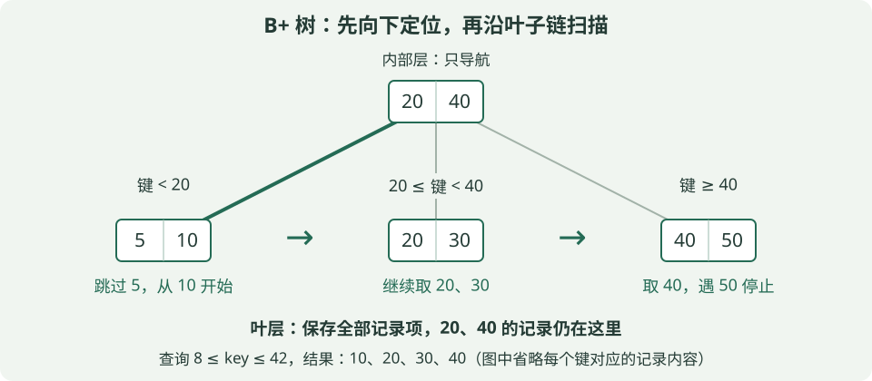

上图约定内部键是**右侧子树的最小键**：小于20走左边，20≤键＜40走中间，键≥40走右边。根的20、40是导航用的副本，叶子中仍保留这些键对应的记录项；这和前面B-tree中间键“上移后不留在叶子”的例子不同。实际教材可能采用不同分隔键约定，看题目定义。

**例题1（范围）：** 查询8≤key≤42。先从根定位到含下界的左叶，跳过5，从10开始；沿叶子链扫描20、30、40，见到50超过上界便停止。结果是 **10、20、30、40**。只需定位一次起点，再顺序扫描，不必为每个键重新从根查找。

**例题2（容量）：** 假设B+树每个内部节点最多100个孩子，每个叶子最多100条记录，树共3层（根→内部节点→叶）。满载最多有 `100×100=10000` 个叶子、`10000×100=1000000` 条记录。根在第1层，只有两次分叉，不能误算成100³个叶子。若每节点恰占一页、只缓存根且不计回表，一次点查沿途仍需读2页；实际不一定满载，也不一定发生两次物理I/O。

这种“内部页只放导航信息、叶层顺序相连”的结构，有利于增加分支数并处理范围查询。参见[Cornell的B树家族与局部性讲解](https://www.cs.cornell.edu/courses/cs3110/2011sp/Recitations/rec24-B-trees/B-trees.htm)。

**落到MySQL InnoDB，记住“索引里有没有我要的列”。** 聚簇索引叶页保存行数据；二级索引记录包含索引列和主键，可能先查到主键，再去聚簇索引找其余列，这叫回表。若索引已包含查询所需的列，可形成覆盖索引，减少这次查找。不要把“B+树叶子存数据”机械理解成“每一种索引叶子都存整行”。依据：[InnoDB聚簇索引与二级索引](https://dev.mysql.com/doc/refman/8.4/en/innodb-index-types.html)。

**复合索引 `(a,b)` 先按a，再在相同a内部按b排序。** `a=2 AND b=7` 可按完整前缀定位；只有 `b=7` 时，命中项可能散落在不同a的区间，不能直接套用相同的前缀定位方法。这里说的是通常的查找方式；优化器也可能选择扫描或跳跃扫描，不能背成“没有最左列就绝对不会用索引”。索引还占空间，插入／删除／更新相关列有维护成本，越多不一定越好。依据：[MySQL复合索引](https://dev.mysql.com/doc/refman/8.4/en/multiple-column-indexes.html)。

### ⑦ 缓存：先判断是不存在、单热点还是大面积失效

| 问题 | 发生什么 | 常见应对思路 |
|---|---|---|
| 穿透 | 反复请求不存在的数据，每次都绕过缓存查后端 | 短期缓存空结果，或用布隆过滤器挡住明确不存在的键 |
| 击穿 | 一个热点key失效，大量请求同时去重建 | 合并同一key的重建请求、互斥重建，或按业务允许提供旧值 |
| 雪崩 | 大量key集中到期，或缓存服务整体不可用 | TTL随机抖动缓解集中到期；整体故障还需高可用、限流与降级 |

**例题：** 一万个key都在12:00到期，加随机TTL可分散失效时刻；若只有一个超级热点key失效，单靠TTL随机化不能消除同一时刻的并发重建。缓存三类问题不能用同一个措施包打天下。

### ⑧ 事务、幂等与消息重投：协议可靠不等于业务只做一次

**事务**把一组操作作为一个逻辑单元；数据库唯一约束可阻止重复业务键。**幂等**是同一请求重复执行，最终业务效果与执行一次一致；仅加一把可能过期的锁，不能保证所有重试与崩溃场景都正确。

消息“至少一次投递”意味着可能重投，消费侧常需幂等。业务提交后、ACK前崩溃，消息可能再次到达；先ACK再处理，又可能在崩溃时丢掉业务处理。

**例题：** 同一订单消息重投两次，不能每次都直接余额减100。可用唯一的业务幂等键识别重复，并把“记录已处理”和“扣款”放入合适的原子事务中；重复时复用原处理结果。若扣款跨外部系统，还需对方的幂等接口或相应一致性设计，单个本地事务不能自动覆盖所有外部动作。

本节协议与索引例题、练习均为新编教学题；引用标准和课程资料用于核对概念，不代表阿里官方题目或考频统计。

## 12. 合上讲义，做两次复述

第一次只讲Infra：显存有哪些项？DP／TP／PP切什么？ZeRO各阶段分什么？KV公式的2与头数是什么意思？延迟和吞吐差在哪？

第二次只讲计算机基础：栈与队列出元素的顺序？堆是否整体有序？BST为何会退化？BFS和Dijkstra各有什么前提？TCP为何需要应用分帧？缓存三类问题如何区分？

Fenwick、带权并查集、在线Softmax合并等进阶内容，可在基本概念稳定后进一步学习；本讲义先覆盖基础层，不把这些推导塞进第一轮。
