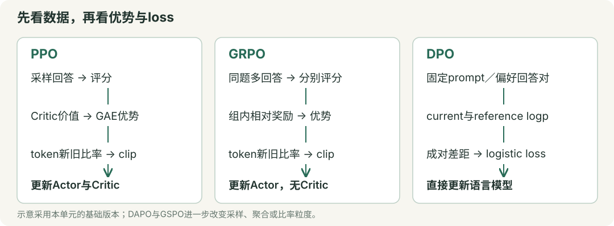

# 单元8 · 强化学习与偏好优化算法

本单元把PPO、GRPO、DAPO、GSPO与DPO串起来：先弄清“奖励如何变成更新信号”，再区分概率比值、裁剪、KL和loss聚合。公式均使用自然对数；带帽子的量表示估计值，计算题给定的标准差口径、mask和聚合方式以题设为准。



## 1. 语言模型怎样成为一个策略？

### ① 状态、动作与三种概率

在文本生成中，状态 $s_t=(x,y_{<t})$ 是prompt $x$ 加上已经生成的前缀；动作 $a_t=y_t$ 是下一个token。策略 $\pi_\theta(a_t\mid s_t)$ 就是语言模型给这个token的条件概率，$\theta$ 是可训练参数。

| 记号 | 含义 | 后面用在哪里 |
| --- | --- | --- |
| $\pi_\theta$ | 当前正在更新的策略 | 计算当前log-prob和梯度 |
| $\pi_{old}$ | 采集这一批rollout时的策略 | PPO／GRPO的重要性比率分母 |
| $\pi_{ref}$ | 作为参照的策略，通常在一个训练阶段内冻结 | reference KL或DPO参考分数 |

rollout是一次采样得到的回答／轨迹。一次更新期间，old与reference可以起初参数相同，但职责不同；old会随下一轮采样刷新，reference按训练方案固定或阶段性刷新。

### ② 从logits到整条回答的log-prob

设词表大小为 $V_{vocab}$，当前位置第 $v$ 个token的logit为 $z_v$：

$$p_v=\frac{e^{z_v-z_{max}}}{\sum_j e^{z_j-z_{max}}},\qquad \log p_v=z_v-\operatorname{logsumexp}(z)$$

减去同一个最大logit不改变概率，可避免指数溢出。实现中通常直接用 `log_softmax`，再取**实际生成或给定的那个token**的值。

**例：** logits为 $(\log2,0)$，概率为 $(2/3,1/3)$；若给定token是第二个，它的log-prob为 $\log(1/3)\approx-1.099$。

自回归回答的条件概率是逐token概率的乘积，因此log-prob是和：

$$\log\pi_\theta(y\mid x)=\sum_{t=1}^{T}\log\pi_\theta(y_t\mid x,y_{<t})$$

例如两个response token的概率为 $1/2,1/4$，回答概率为 $1/8$，log-prob为 $-\log8\approx-2.079$。prompt参与条件上下文，但本单元的回答loss只统计有效response token，排除prompt与padding；实现时还要将预测位置与目标token正确错位对齐。

依据：[策略与log-prob基础](https://spinningup.openai.com/en/latest/spinningup/rl_intro3.html)。Softmax可回看[单元4](unit-4.html#lesson-2)。

## 2. Reward、Return与Advantage为什么要分开？

### ① 即时奖励与累计回报

$r_t$ 是执行当前动作后的即时奖励；$\gamma\in[0,1]$ 是未来奖励的折扣系数。从当前步算起的采样回报为：

$$G_t=\sum_{l=0}^{T-t-1}\gamma^l r_{t+l}$$

**例：** 剩余奖励为 $(1,2,4)$，$\gamma=1/2$，则 $G_t=1+(1/2)2+(1/4)4=3$，既不是当前奖励1，也不是不折扣的总和7。LLM的终局评分可以只在最后一个有效token处给出；KL等奖励塑形也可分布在中间步骤。

### ② Advantage：比这个状态的通常表现好多少？

以下价值都针对同一策略：$V^\pi(s)$ 是从状态 $s$ 出发按策略继续行动的期望回报；$Q^\pi(s,a)$ 是先选择动作 $a$、之后再按策略行动的期望回报。

$$A^\pi(s,a)=Q^\pi(s,a)-V^\pi(s)$$

**例：** 状态本来就容易取得8分，某动作的预期回报是10分，优势为2；另一个动作得到6分，优势为−2。用采样回报时，$G_t-V(s_t)$ 是一个估计，不能把一次结果直接当成精确的 $Q$。

策略梯度可用回报加权；采用状态baseline通常为了降低采样方差。给定 $s$，动作按该策略采样、baseline $b(s)$ 不依赖当前动作且作为固定权重时：

$$\mathbb E_{a\sim\pi_\theta}[b(s)\nabla_\theta\log\pi_\theta(a\mid s)]=b(s)\nabla_\theta\sum_a\pi_\theta(a\mid s)=0$$

所以减去这样的baseline不会改变这一项的期望梯度。并非“必须用Advantage才能训练”；REINFORCE也能直接用回报。对固定样本的策略更新贡献，正优势鼓励提高该动作概率，负优势鼓励降低；参数共享及其他loss意味着每步不保证所有样本都如愿变化。

依据：[策略梯度与baseline](https://spinningup.openai.com/en/latest/spinningup/rl_intro3.html#baselines-in-policy-gradients)。

## 3. TD error与GAE：优势是怎样算出来的？

### ① TD error：用一步真实奖励加后续预测

Critic $V_\phi(s)$ 是预测状态价值的模型，$\phi$ 是它的参数。对非终止转移，一步TD error为：

$$\delta_t=r_t+\gamma V_{old}(s_{t+1})-V_{old}(s_t)$$

$V_{old}$ 指采样时保存的价值预测。前两项是一步bootstrap target，减去原预测得到误差；也可把它视为一步Advantage估计。

**例：** $r_t=2,\gamma=0.9,V_{old}(s_t)=5,V_{old}(s_{t+1})=6$，则 $\delta_t=2+5.4-5=2.4$。

**真正终止时，后续价值置0。** 若当前预测5、终止奖励2，则误差是 $2-5=-3$。仅因时间／长度上限截断是否bootstrap要按任务定义处理，不能把所有截断都等同于环境终止；分段rollout还需在边界处停止跨段递推。

### ② GAE：从后往前累加TD error

GAE（广义优势估计）用 $\lambda\in[0,1]$ 控制未来TD error的衰减。在一条正常终止的轨迹内：

$$\hat A_t=\delta_t+\gamma\lambda\hat A_{t+1},\qquad \hat A_T=0$$

展开为 $\hat A_t=\sum_{l=0}^{T-t-1}(\gamma\lambda)^l\delta_{t+l}$。$\gamma$ 控制未来奖励折扣，$\lambda$ 控制估计中多步信息的混合，二者不是同一个旋钮。

**手算：** 已算好 $\delta_0=1,\delta_1=2$，$\gamma=0.9,\lambda=0.5$。先算末步 $\hat A_1=2$，再算 $\hat A_0=1+0.45\times2=1.9$。

| 取值 | 结果 | 依赖与取舍 |
| --- | --- | --- |
| $\lambda=0$ | $\hat A_t=\delta_t$ | 一步bootstrap，更依赖价值预测 |
| $\lambda=1$ 且正常终止、末状态价值为0 | $\hat A_t=G_t-V_{old}(s_t)$ | 中间价值项抵消，得到MC形式 |
| $0<\lambda<1$ | 混合多步估计 | 常用于偏差与方差的折中，非无条件保证 |

例如两步展开：$\delta_t+\gamma\delta_{t+1}=r_t+\gamma r_{t+1}-V_{old}(s_t)+\gamma^2V_{old}(s_{t+2})$。正常终止才去掉最后的bootstrap项。

Critic的固定监督目标常取 $\hat R_t=\hat A_t+V_{old}(s_t)$。**先用未标准化的GAE构造target，再按需标准化给Actor使用的优势。** 例如旧价值2、原始GAE为3，则target为5；即使Actor优势被标准化为1，target仍为5。

依据：[GAE原论文](https://arxiv.org/abs/1506.02438)。

## 4. PPO：为什么有old policy和clip？

### ① 新旧概率比：同一个已采样动作变化了多少？

$$\rho_t=\frac{\pi_\theta(a_t\mid s_t)}{\pi_{old}(a_t\mid s_t)}=\exp(\log\pi_\theta-\log\pi_{old})$$

分子分母用**同一个状态、同一个动作**。old概率在这批数据更新期间固定，当前概率每次重新计算；不需要始终在显存里另放一个old模型，保存old log-prob即可满足这部分计算。

**例：** old概率0.20、当前0.24，$\rho=1.2$，相对提高20%；若old log-prob为−1.5、当前为−1.3，则 $\rho=e^{0.2}\approx1.221$。不要相除两个log-prob。

重要性比率用于管理行为策略与当前策略的差异。PPO通常归为on-policy算法，使用近期采样并做有限轮更新；有这个比率不意味着可以无限重用任意旧数据，也不意味着单个token比率能完整修正整条轨迹的状态分布。

### ② 四种情况一起看懂clip

定义要**最大化**的单样本代理目标 $S_t$，以及要**最小化**的policy loss：

$$S_t=\min\left(\rho_t\hat A_t,\operatorname{clip}(\rho_t,1-\varepsilon,1+\varepsilon)\hat A_t\right),\qquad \ell_t^{policy}=-S_t$$

$\varepsilon$ 是比率裁剪宽度。取 $\varepsilon=0.2$，区间为 $[0.8,1.2]$：

| 优势与比率 | 原始项 $\rho A$ | clip后的项 | 取min得到 $S$ | 含义 |
| --- | --- | --- | --- | --- |
| $A=1,\rho=1.3$ | 1.3 | 1.2 | 1.2 | 好动作继续涨的额外收益封顶 |
| $A=-1,\rho=0.6$ | −0.6 | −0.8 | −0.8 | 差动作继续降的额外收益封顶 |
| $A=1,\rho=0.6$ | 0.6 | 0.8 | 0.6 | 好动作概率下降，仍需纠正 |
| $A=-1,\rho=1.3$ | −1.3 | −1.2 | −1.3 | 差动作概率上升，仍需纠正 |

**clip改变的是代理目标的激励，并不把真实概率比强行截成 $[0.8,1.2]$，也不保证KL小于某个常数。** 一个样本的代理项饱和后，该项不再奖励继续向该方向变化；共享参数仍可能因其他样本、价值loss或正则项而变化。

依据：[PPO原论文](https://arxiv.org/abs/1707.06347)、[PPO-Clip的分情况解释](https://spinningup.openai.com/en/latest/algorithms/ppo.html)。

## 5. PPO完整训练：谁学习，谁保持固定？

### ① Actor、Critic与一轮更新

| 角色／数据 | 职责 | 本轮minibatch更新时 |
| --- | --- | --- |
| Actor $\pi_\theta$ | 给下一个token分配概率 | 更新参数 |
| Critic $V_\phi$ | 预测未来回报 | 拟合固定value target |
| Reward model或规则验证器 | 为结果提供评分 | 常固定；它不是Critic |
| old log-prob、GAE、value target | 这一批rollout的训练数据 | 固定，不反向传播 |

Reward model可能是学到的人类偏好评分器，并不等同于客观正确性检查；规则验证器则可检查答案、测试用例等。Actor和Critic可共享部分网络，角色数量不能直接当成完整模型副本数量。

一轮流程：**当前策略采样 → 评分、保存old log-prob和旧价值 → 计算GAE与target → 多轮minibatch更新 → 用更新后的策略重新采样**。固定数据重用若干epoch有助于样本利用，但不能永远训练同一批rollout。

简化总loss为：

$$L=-\operatorname{mean}(S_t)+c_v\operatorname{mean}\left[\tfrac12(V_\phi(s_t)-\hat R_t)^2\right]-c_e\operatorname{mean}(H_t)$$

$c_v,c_e\ge0$ 分别为value loss与熵奖励系数。例：policy项 $S=1.2$、新价值3、target5、熵0.5，取 $c_v=0.5,c_e=0.1$，则value loss为2，总loss为 $-1.2+0.5\times2-0.1\times0.5=-0.25$。本式未包含reference KL；若KL已进入reward，再加loss项须确认不会重复惩罚。

### ② 熵、KL、clip fraction应该怎样读？

策略熵在每个状态对**整个词表**求和：$H_t=-\sum_v p_v\log p_v$。均匀二分类的熵为 $\log2$，完全确定的分布熵为0。最小化loss时，鼓励熵增加的项带负号。

| 指标 | 要观察的内容 | 不宜直接推出的结论 |
| --- | --- | --- |
| Reward／验证集表现 | 学到目标了吗，有无利用评分漏洞 | reward涨不等于能力全面提升 |
| old／reference KL | 一轮变化／相对参照的累积偏离 | 两种KL不能混读 |
| Entropy与回答多样性 | 是否迅速变得单一 | 熵越大并非越好 |
| Clip fraction | 按实现统计多少比率越界／代理项激活裁剪 | 越界不一定落在饱和分支；低值也不单独证明没学到 |
| Value loss | Critic是否拟合target，尺度是否变化 | 低value loss不单独证明Actor更好 |

若动作确实从当前策略采样，$-\log\pi_\theta(a\mid s)$ 的期望等于熵；但从old策略采样后直接平均不是当前精确熵，且把固定采样token的负log-prob直接反传也不自动得到正确熵梯度。

依据：[PPO训练流程](https://spinningup.openai.com/en/latest/algorithms/ppo.html)。

## 6. Reference KL：限制偏离的是谁？

### ① old与reference分别管什么？

| 对比对象 | 主要用途 | 常见设置 |
| --- | --- | --- |
| $\pi_{old}$ 与 $\pi_\theta$ | 衡量这批rollout更新了多大一步 | old随新一轮采样刷新 |
| $\pi_\theta$ 与 $\pi_{ref}$ | 相对参照保留原有行为 | reference通常在训练阶段内冻结 |

固定状态下，精确正向KL为：

$$D_{KL}(\pi_\theta\Vert\pi_{ref})=\sum_a\pi_\theta(a\mid s)\log\frac{\pi_\theta(a\mid s)}{\pi_{ref}(a\mid s)}$$

它非负，交换两分布通常不同。LLM实际常用采样估计，避免每步精确遍历词表。**一个采样token的 $\log\pi_\theta-\log\pi_{ref}$ 可以为负**，非负性属于完整KL，不属于每个这样的样本值。

**例：** 当前概率 $(1/2,1/2)$、reference $(3/4,1/4)$，则KL为 $\tfrac12\log(2/3)+\tfrac12\log2=\tfrac12\log(4/3)\approx0.144$；第一个动作的采样log比却为负。

RLHF常优化“期望评分 $-\beta_{KL}D_{KL}$”，其中 $\beta_{KL}\ge0$ 是惩罚强度。可把采样log比的负值乘系数加入reward；另一种实现将KL直接加在loss中，须明确所用方案。

### ② GRPO常见的非负单token估计

用 $u$ 表示reference与当前概率的比，避免和奖励 $r_t$、新旧比率 $\rho$ 混淆：

$$u=\exp(\log\pi_{ref}-\log\pi_\theta),\qquad \hat k=u-\log u-1$$

由 $\log u\le u-1$，$\hat k\ge0$；两概率相同才等于0。**例：** $u=2$，$\hat k=1-\log2\approx0.307$。

若动作按当前策略采样且两分布在动作空间有共同正支持，则 $\mathbb E_{\pi_\theta}[u]=1$，所以 $\mathbb E_{\pi_\theta}[\hat k]=D_{KL}(\pi_\theta\Vert\pi_{ref})$。更新期间rollout来自old策略，直接平均不再自动满足这个精确无偏关系；须关注采样分布、权重和实现。这个 $u$ 的分子是reference，PPO的 $\rho$ 分子则是current。

依据：[DeepSeekMath的KL项](https://arxiv.org/html/2402.03300v3#S4.SS1.SSS1)。熵与KL定义见[单元3](unit-3.html#lesson-7)。

## 7. GRPO：用同题多回答替代Critic基线

### ① 从组内奖励算优势

同一prompt采样 $G$ 条回答 $y_1,\ldots,y_G$，奖励为 $R_1,\ldots,R_G$。本节采用**总体标准差**和正的数值稳定项 $\epsilon_{std}$：

$$\bar R=\frac1G\sum_iR_i,\quad \sigma_R=\sqrt{\frac1G\sum_i(R_i-\bar R)^2},\quad \hat A_i=\frac{R_i-\bar R}{\sigma_R+\epsilon_{std}}$$

**例：** $R=(1,1,0,0)$，均值0.5、总体标准差0.5；忽略极小稳定项，优势为 $(1,1,-1,-1)$。若用样本标准差，数值不同，计算题必须说明口径。

如果奖励全相同，分子全为0；加稳定项后优势全0。该组不给策略代理目标提供梯度，但KL或其他项仍可能更新模型；直接除以0则是实现错误。

在这里的**终局奖励、outcome-supervision版本**中，$\hat A_{i,t}=\hat A_i$，同回答内有效token共享优势。它省去用于预测价值的Critic，仍需奖励来源、old概率，使用KL时还需reference信息。组内相对分数不是精确的状态价值，也不自动等于无偏的 $A^\pi$。

### ② 从每个token的目标聚合为loss

每个token仍有自己的 $\rho_{i,t}=\pi_\theta(y_{i,t}\mid s_{i,t})/\pi_{old}(y_{i,t}\mid s_{i,t})$，按第4节计算 $S_{i,t}$。令 $T_i$ 为第 $i$ 条回答的有效response长度，原始GRPO形式为：

$$J_{GRPO}=\frac1G\sum_i\frac1{T_i}\sum_{t=1}^{T_i}\left(S_{i,t}-\beta_{KL}\hat k_{i,t}\right),\qquad L_{GRPO}=-J_{GRPO}$$

**先每条回答内部平均，再对回答平均。** reward和优势可以是回答级，比率和clip仍是token级；不要把这三个层次混为一谈。

**例：** 2条回答各有2个有效token。四个 $S$ 为 $(1.2,1.0)$ 和 $(-0.8,-1.0)$，平均分别为1.1、−0.9，组平均为0.1；若同口径平均KL为0.2、$\beta_{KL}=0.1$，则 $J=0.1-0.02=0.08$，loss为−0.08。

序列奖励能作用到token，是因为 $\nabla\log\pi_\theta(y\mid x)=\sum_t\nabla\log\pi_\theta(y_t\mid s_t)$；这并不说明每个token的真实贡献都一样，也不意味着它们有相同的概率比率。

依据：[DeepSeekMath的GRPO与终局监督](https://arxiv.org/html/2402.03300v3#S4.SS1)。

## 8. DAPO：裁剪、采样和长度权重分别改了什么？

### ① 两种平均：必须写清分母

下面仅比较同一组逐token量 $\ell_{i,t}$ 的聚合，暂不考虑不同裁剪参数或KL：

$$L_{seq}=\frac1G\sum_i\frac1{T_i}\sum_t\ell_{i,t},\qquad L_{token}=\frac{\sum_i\sum_t\ell_{i,t}}{\sum_iT_i}$$

| 两条回答长度2与4 | 短回答总权重 | 长回答总权重 | 单个token权重 |
| --- | --- | --- | --- |
| 原始GRPO式先回答内平均 | $1/2$ | $1/2$ | 短：$1/4$；长：$1/8$ |
| DAPO式全部有效token平均 | $1/3$ | $2/3$ | 全部为 $1/6$ |

**手算：** 短回答逐token量 $(1,1)$，长回答 $(3,3,3,3)$。回答等权平均为 $(1+3)/2=2$；token等权平均为 $(2+12)/6=7/3$。长回答的总权重增加，不能误写成两条都占 $1/3$。

这是聚合权重的区别，不等于长回答一定更好；多个prompt、分布式累积时也应核对最终分母和mask。

### ② DAPO的其他改动与适用场景

| 改动 | 做法 | 记忆要点 |
| --- | --- | --- |
| Clip-Higher | clip区间为 $[1-\varepsilon_{low},1+\varepsilon_{high}]$，提高上侧宽度 | 如0.2／0.28得到 $[0.8,1.28]$；仍非真实比率的硬限制 |
| Dynamic Sampling | 论文按组内正确率过滤全对／全错组，继续采样补足有效组 | 仅有二元正确性奖励时，这等价于排除零方差组 |
| Token级聚合 | 所有有效token共同平均 | 改的是loss reduction，不是把终局reward改成逐tokenreward |
| Overlong Reward Shaping | 处理硬截断噪声，并在上限前逐渐惩罚过长回答 | 截断不代表所有已生成推理都错误 |

以论文中的软长度惩罚规则为例，$L_{max}$ 为长度上限、$L_{cache}>0$ 为缓冲长度：

$$R_{len}(T)=\begin{cases}0,&T\le L_{max}-L_{cache}\\ \frac{L_{max}-L_{cache}-T}{L_{cache}},&L_{max}-L_{cache}<T\le L_{max}\\ -1,&T>L_{max}\end{cases}$$

**例：** $L_{max}=100,L_{cache}=20$，长度80惩罚0、90惩罚−0.5、100惩罚−1。可与正确性奖励相加。论文还研究了mask硬截断样本loss的Overlong Filtering；具体哪些样本保留、如何评分，按实现配置区分。

叠加长度惩罚后，全对组也可能有不同的最终reward；**按正确性筛选与按最终reward方差筛选不再等价**，须区分评分与筛选配置。

原论文的数学长推理配置移除了reference KL，采用可验证结果奖励。这是特定训练设计，不能推成“所有任务都不需要KL”；也不能由没有Critic推出没有old策略。

依据：[DAPO原论文§2–3](https://arxiv.org/html/2503.14476v1)。

## 9. GSPO：把比率与clip移到回答级

### ① 一个回答共用一个长度归一化比率

原始GSPO对每条回答定义：

$$s_i=\left(\frac{\pi_\theta(y_i\mid x)}{\pi_{old}(y_i\mid x)}\right)^{1/T_i}=\exp\left(\frac1{T_i}\sum_t\log\rho_{i,t}\right)$$

这里 $s_i$ 是比率，别与状态 $s_t$ 混淆。它是token比率的**几何平均**，不是算术平均，也不是未经长度归一化的序列概率比。

**例：** 两个token的比率为2和 $1/2$，序列概率比为1，$s_i=\sqrt1=1$；算术平均却是1.25。若3个token比率都是1.1，原始序列比为 $1.1^3$，归一化后仍为1.1。

### ② 同样是group优势，更新粒度变了

$$J_{GSPO}=\frac1G\sum_i\min\left(s_i\hat A_i,\operatorname{clip}(s_i,1-\varepsilon,1+\varepsilon)\hat A_i\right)$$

原始GSPO在回答级做裁剪；原始GRPO／DAPO在token级裁剪。例如两个比率为2和 $1/2$、$A=1,\varepsilon=0.2$：GRPO该回答的代理平均为 $(1.2+0.5)/2=0.85$；GSPO用 $s=1$，代理值为1。

GSPO仍通过回答内token的log-prob反向传播，并非只更新最后一个token。它以序列粒度降低某些长回答／MoE训练中的比率波动；具体稳定性依赖任务和实现，不能把论文实验结论当作所有场景保证。实际GSPO裁剪超参数也不能直接照搬上面便于手算的0.2。

依据：[GSPO原论文公式5–10](https://arxiv.org/html/2507.18071v2)。

## 10. DPO：用chosen／rejected直接学习相对偏好

### ① 四个log-prob怎样组成一个loss？

一条训练数据为 $(x,y_w,y_l)$：$x$ 是prompt，$y_w$ 是偏好的chosen回答，$y_l$ 是不偏好的rejected回答。标准DPO在固定偏好对上训练，不需要每步在线rollout、Critic或另训练一个显式Reward Model。

对两个给定回答分别做teacher forcing：输入prompt与回答前缀，取每个目标token的log-prob，按有效response token**求和**。这样得到当前模型的两个分数和reference的两个分数；不是让模型先自由生成，再看它是否刚好生成chosen。

$$\Delta_\theta=\log\pi_\theta(y_w\mid x)-\log\pi_\theta(y_l\mid x),\qquad \Delta_{ref}=\log\pi_{ref}(y_w\mid x)-\log\pi_{ref}(y_l\mid x)$$

$$z=\beta_{DPO}(\Delta_\theta-\Delta_{ref}),\qquad L_{DPO}=-\log\sigma(z)=\log(1+e^{-z})$$

$\beta_{DPO}>0$ 为DPO系数；$\sigma(z)=1/(1+e^{-z})$ 为sigmoid。$\Delta$ 是**两个序列log概率的差**，不是两个概率直接相减。原始DPO用序列log-prob之和，长度归一化属于需要另行说明的变体。

为什么会有reference？在KL正则的奖励最大化推导中，可把隐式奖励写为 $\hat r(x,y)=\beta_{DPO}\log[\pi_\theta(y\mid x)/\pi_{ref}(y\mid x)]+c(x)$。成对偏好模型采用 $\sigma(\hat r_w-\hat r_l)$，同prompt的 $c(x)$ 抵消，就得到上面的 $z$。reference已在此损失结构中体现，无需把它误认为PPO的old策略。

**手算：** 当前chosen／rejected log-prob为−2／−4，reference为−3／−4，$\beta_{DPO}=1$。当前gap为2，参考gap为1，所以 $z=1$，偏好概率约0.731，loss约0.313。初始当前模型与reference相同则 $z=0$、loss为 $\log2\approx0.693$，但其梯度通常不为0。

### ② 更新方向、代码与reference的存储

最小实现的核心可写为：

```python
# 四个logp均为对齐并mask后的response token log-prob之和。
# ref分数来自冻结reference的no_grad计算，或提前缓存。
current_gap = chosen_logp - rejected_logp
reference_gap = ref_chosen_logp - ref_rejected_logp
z = beta_dpo * (current_gap - reference_gap)
loss = -F.logsigmoid(z).mean()
```

使用 `logsigmoid` 可避免先sigmoid再log的数值问题。固定reference时：

$$\frac{\partial L}{\partial\Delta_\theta}=-\beta_{DPO}\sigma(-z)<0$$

因此目标鼓励扩大chosen相对rejected的log概率差；**并不保证chosen的绝对概率每步都上升**。例如chosen概率从0.4降至0.3，rejected从0.2降至0.1，相对比值仍从2增至3。多个样本的梯度也可能互相影响。

$\sigma(z)$ 是偏好损失构造的概率，不是给语言模型新加一个“选A／B”的分类输出头；训练后的模型仍生成token。DPO与SFT的区别是前者比较偏好对及reference，后者通常只对目标回答做负log似然。

标准DPO需要reference评分信息，**不必无条件常驻第二份完整模型**：固定数据、固定reference及相同分词／截断／mask方案下可预计算并缓存参考log-prob；也有适配器共享底座的实现。reference不跟随当前模型每步更新，否则目标改变。$\beta_{DPO}$ 来自KL正则推导，也影响梯度尺度，不能简单视为“越大就总是学得越快”。

依据：[DPO原论文§4及附录](https://arxiv.org/html/2305.18290)、[TRL的reference预计算与训练选项](https://huggingface.co/docs/trl/dpo_trainer)。

## 11. 一张表把算法关系串起来

| 方法 | 数据与评分 | 优势来源 | 比率／裁剪 | 关键训练结构 |
| --- | --- | --- | --- | --- |
| PPO（本单元Actor–Critic版本） | 近期在线rollout＋reward | Critic＋GAE | token级current／old | Actor与Critic更新，固定本批旧量 |
| GRPO（原始终局监督版本） | 同prompt多条rollout＋reward | 组内相对奖励 | token级current／old | 无Critic，先回答内平均再组平均，原式含reference KL |
| DAPO（论文配置） | 同题分组rollout＋可验证奖励 | 组内相对奖励 | token级，非对称clip | token等权聚合、动态采样、长度塑形，移除reference KL |
| GSPO（原始版本） | 同题分组rollout＋reward | 组内相对奖励 | 长度归一化sequence比率 | 整条回答裁剪，仍通过token log-prob更新 |
| DPO（标准离线版本） | 固定prompt／chosen／rejected | 不算GAE／组优势 | current与reference的成对log差 | logistic偏好loss，直接更新语言模型 |

答题先辨认四件事：**数据来自rollout还是固定偏好对？优势从哪里来？比率比较的是old还是reference？最后按token还是回答平均？** 再代数字，避免只凭算法名套公式。

公开考点回忆可提供练习方向：[牛客上的GAE与PPO／GRPO／DPO问答线索](https://www.nowcoder.com/discuss/927018114900922368)、[牛客上的DAPO／GSPO比较线索](https://www.nowcoder.com/discuss/921942180380299264)。它们不构成考频统计，技术定义以上述原论文和官方文档为准；本单元例题与选择题均为重新编写的教学练习。
